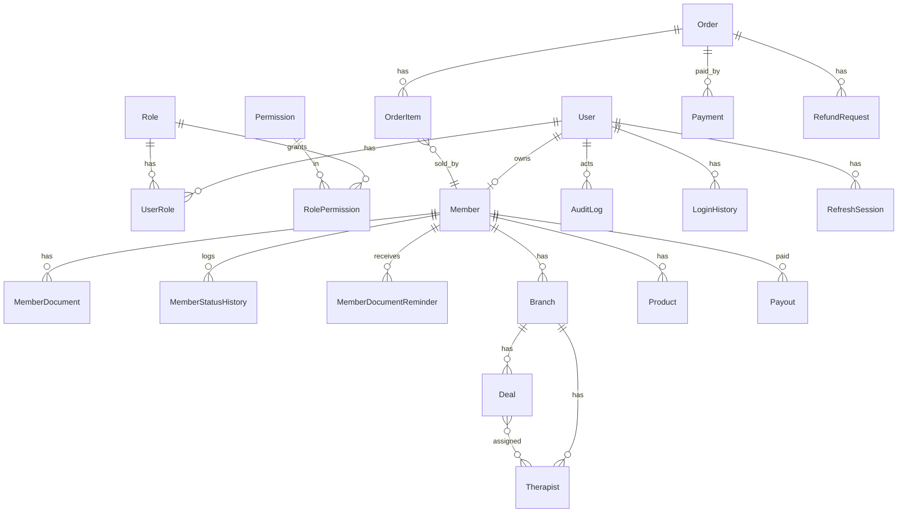

# MSD Admin RBAC: Master Plan (single source of truth)

Status: proposed baseline, 2026-10-14. Needs owner sign-off on section 10 before build.
Scope: `apps/msd-api`, `packages/shared-{types,permissions,menu,auth}`, `apps/msd` admin console. `mera-driver*` untouched.

## 0. How this file relates to the others

| File | Role after this file lands |
|---|---|
| `ADMIN_USER_ROLES_AND_PERMISSIONS.md` | Business rules. Wins any conflict on **who can do what**. |
| **This file** | Technical truth: roles, resources, actions, scope, DB, endpoints, OpenAPI, validation, security, plan. Wins any conflict between the technical drafts. |
| `ADMIN_RBAC_BACKEND_SPEC.md` | Superseded by sections 3 to 9. Keep for history. |
| `ADMIN_RBAC_TASKS.md` | Still the task tracker. Apply the 9 corrections in section 12 first. |
| `raj/ADMIN_RBAC_API_DB_ENDPOINTS.md`, `raj/ADMIN_RBAC_BACKEND_GAP.md` | Superseded. Their open questions are merged into section 10. |

Precedence when documents disagree: business role doc, then this file, then code facts verified in section 1.

---

## 1. Verified baseline (checked against this branch, `feature/all-member-matrix-sandeep-5oct26`)

| # | Fact | Evidence | Effect on the plan |
|---|---|---|---|
| F1 | `PermissionScope` enum and `RolePermission.scope` are **not on this branch**. They exist only on `origin/feature/msd-updated-code-raj-23sep2026` (migration `20261008104219_add_permission_scope`, not merged here). | grep of `schema.prisma` and migrations; `git merge-base` says not an ancestor | Raj's "do not create it twice" is right, but the migration is not here. Task P1-01 becomes **merge or cherry-pick that migration**, then verify. Do not write a second one. |
| F2 | `requirePermission` is flat (`menuKey:action`), no `req.access`, no scope. | `src/middleware/requirePermission.ts` has no scope code | Scope enforcement is fully unbuilt on both branches. |
| F3 | Seed has 6 roles: `super_admin, admin, customer, vendor, marketing, sales`. No `support`. | `prisma/seed.ts` L38-43 | Add `support`, rename `vendor`. |
| F4 | `vendor-portal.*` keys are seeded as a separate narrow permission set for the vendor role. | seed.ts L128-134, L314-329 | Collapse into the 14 keys with OWN scope. |
| F5 | `VendorStatus` has 7 values (`PROFILE_INCOMPLETE, PENDING_VERIFICATION, APPROVED, REJECTED, ACTIVE, INACTIVE, SUSPENDED`). | schema L1621 | Needs the 4-state `MemberStatus` plus data map. |
| F6 | `VendorDocument` has only `storageKey, originalFilename, mimeType, sizeBytes`, one row per type. No status, number, reviewer, expiry. | schema L336 | Extend as `MemberDocument`. |
| F7 | `PaymentStatus` is `CREATED, PAID, FAILED, CANCELLED`. No `RefundRequest`, `Payout`, `SystemSetting`, `MemberStatusHistory`, `MemberDocumentReminder` models. | schema grep | All new tables. |
| F8 | `app.ts` has `cors` and `express.json` with no `limit`; no `helmet`, no `trust proxy`, no global rate limiter. `/docs` is mounted unconditionally. | `src/app.ts` L53-70 | Hardening tasks stand. |
| F9 | A `SupportRequest` model exists (customer contact-us message, `customerId, subject, message`). It is **unrelated** to the new `support` staff role. | schema L41 | Name collision. Keep `SupportRequest` as is. Never reuse it for refunds. |
| F10 | `User.deletedAt` exists. `Branch`, `Deal`, `Therapist`, `Product` have no `deletedAt`. | schema L24 | Add soft delete per section 4. |
| F11 | `nx.json` `defaultBase` and branch flow: `feature/* -> develop -> release -> main`. | CLAUDE.md | Work branch off `develop` (P0-04). |

Taken from the Raj documents and **not re-verified** by me (verify when each task starts): order-item vendor filtering in `order.service`, KYC magic-byte and 5 MB check, Razorpay webhook raw-body HMAC with timing-safe compare, role service preserving `scope` on clone, audit helper swallowing failures, `/reports/*` current route names, vendor schema PAN/GST regex.

---

## 2. Decisions this file takes (so the drafts stop disagreeing)

| # | Conflict | Decision | Why |
|---|---|---|---|
| R1 | Business doc: 7 fixed roles, hide New/Clone. Architecture docs: dynamic custom roles. Raj flagged it. | **Fixed roles.** `POST /rbac/roles`, `/clone`, `DELETE` return 403 `ROLE_MANAGEMENT_LOCKED`. Super admin may still edit grants of the 6 staff-facing roles. Re-open only if the owner asks for custom roles. | Business doc is dated 2026-10-05 and marked final. |
| R2 | Spec says `scope` is a new migration. Raj says it exists. | Exists on Raj branch only (F1). Merge it. | Verified. |
| R3 | Spec: `.strict()` on every body now. Raj: breaks current clients. | **Staged.** All new and changed endpoints are `.strict()` from day one. Existing endpoints switch when the frontend is confirmed clean, tracked per route in the route inventory test (P4-12). | Avoids a silent break of msd. |
| R4 | Spec: audit is transactional. Code: audit is best-effort. | **Mandatory audit** (status change, document review, refund, payout, delete, role grant) runs in the same transaction and fails the request on write failure. Read-type audit (download, export) stays best-effort but alerts. | Evidence loss on money and PII is worse than a failed request. |
| R5 | Customer block: spec says `active\|blocked`, code `UserStatus` has `inactive`. | API accepts `active \| blocked`; maps to `UserStatus` (`ACTIVE`, `BLOCKED`, add `BLOCKED` if missing). Reason required, stored on `User.statusReason`. | One word in UI and API. |
| R6 | Refund: dedicated `refunds` key or reuse `orders:*`. | Reuse. `orders:custom` raises, `orders:approve` decides. Keeps 14 resources. | Business doc lists 14. |
| R7 | Paths: rename to flat `/members`, `/branches` or keep nested `/vendors/...`. | Canonical flat paths (section 6). Old paths stay as deprecated aliases for one release with a `Deprecation` header and a usage log. | Scope makes the nested owner path redundant. |
| R8 | Customer role in admin console. | `customer` has **no admin permission grants**. Its self-service routes (`/orders/me`, wishlist, cart, profile) stay authenticated-only and are not permission keys. Console menu for customer is rendered from those, not from RBAC. | Matches business doc; avoids a 15th resource. Confirm in D8. |
| R9 | Support "view only" vs "raise refund". | Support gets `orders:custom` only as the extra. Documents: type and status only, no file key, no download. | Business doc, section 4. |
| R10 | Who is "own" for a member with several users. | One `Member` has one owner `User` today (`Vendor.ownerUserId`). Keep 1:1. Staff accounts under a member are out of scope. | Not specified anywhere; do not invent. |

---

## 3. Roles, resources, actions (final)

### 3.1 Roles (7, all `isSystem`)

| Key | Name | Console access | Notes |
|---|---|---|---|
| `super_admin` | Super Admin | Yes | `isSuperAdmin` flag, auto-granted every permission |
| `admin` | Admin | Yes | No delete anywhere |
| `marketing` | Marketing | Yes | Content owner, view elsewhere |
| `sales` | Sales | Yes | Creates members and their catalog |
| `member` | Member (was `vendor`) | Yes, own data | Never deletes |
| `support` | Support | Yes | View only plus refund request |
| `customer` | Customer | Storefront only | No admin grants (R8) |

### 3.2 Resources (permission keys, 14) and what they replace

Permission format stays `${menuKey}:${action}`. Every key needs a node in `msd-menu.json` or no permission row is generated.

| Key | Replaces |
|---|---|
| `members` | `vendors`, `vendors.group` |
| `branches` | `vendors.branches`, `vendor-portal.branches` |
| `deals` | `vendors.deals`, `vendor-portal.deals` |
| `therapists` | `vendors.therapists`, `vendor-portal.therapists` |
| `products` | `vendors.products`, `products`, `vendor-portal.products` |
| `orders` | `orders`, `vendor-portal.orders` |
| `customers` | `customers`, `vendor-portal.customers` |
| `content` | all `cms.*` |
| `payments` | new (payments and payouts) |
| `reports` | `reports` |
| `staff-users` | `rbac.users` (staff only) |
| `settings` | `settings` |
| `logs` | `rbac.audit-logs`, login history |
| `profile` | `vendor-portal.profile`, settings profile |

Kept outside the 14: `masters.*`, `dashboard`, and the RBAC admin screens `rbac.roles` (super_admin only, view/edit grants).

### 3.3 Actions (existing 16 `PermissionAction` kinds, none added)

Business action mapping:

| Business action | Permission | Roles |
|---|---|---|
| Member status (activate, deactivate, suspend) | `members:status_change` | super_admin, admin |
| Document approve | `members:approve` | super_admin, admin |
| Document reject | `members:reject` | super_admin, admin |
| Manual document reminder | `members:status_change` | super_admin, admin |
| Member delete | `members:delete` | super_admin |
| Order cancel | `orders:status_change` | super_admin, admin |
| Refund request raise | `orders:custom` | support, admin, super_admin |
| Refund approve / reject | `orders:approve` | super_admin, admin |
| Customer block / unblock | `customers:status_change` | super_admin, admin |
| Payout release | `payments:approve` | super_admin |
| Report export | `reports:export` | super_admin, admin |
| Pause / unpublish own branch, deal, therapist, product | `<res>:edit` | member (OWN), staff roles with edit |

### 3.4 Seed matrix (V view, C create, E edit, D delete; scope A = ALL, O = OWN)

| Resource | super_admin | admin | marketing | sales | member | support |
|---|---|---|---|---|---|---|
| members | VCED A | VCE A | V A | VCE A | VE O | V A |
| branches | VCED A | VCE A | V A | VCE A | VCE O | V A |
| deals | VCED A | VCE A | V A | VCE A | VCE O | V A |
| therapists | VCED A | VCE A | V A | VCE A | VCE O | V A |
| products | VCED A | VCE A | V A | VCE A | VCE O | V A |
| orders | V A | V A | none | V A | V O | V A |
| customers | V A | V A | none | V A | none | V A |
| content | VCED A | VCE A | VCE A | V A | none | V A |
| payments | V A | V A | none | none | V O | none |
| reports | V A | V A | none | none | V O | none |
| staff-users | VCED A | V A | none | none | none | none |
| settings | VE A | V A | none | none | none | none |
| logs | V A | V O | V O | V O | V O | V O |
| profile | VE O | VE O | VE O | VE O | VE O | VE O |

Plus the extras in 3.3 (`status_change`, `approve`, `reject`, `export`, `custom`) on top of this matrix, never beyond it.

Two points the business doc leaves implicit, decided here:
- Sales gets **no** status, approve, reject, export, or delete. Only VCE on the five catalog resources.
- Super admin `profile` and `logs` are scope OWN and ALL respectively, as in the matrix. Super admin implicit "all" for every other key comes from the `isSuperAdmin` flag.

### 3.5 Hard rules (enforced in code, not only in seed)

1. Member never deletes, anywhere.
2. Orders, payments, customers have no DELETE route.
3. `members:delete`, `payments:approve`, `staff-users:delete`, `settings:edit` are super_admin only. A role-grant edit cannot give them to another role (`ROLE_GRANT_FORBIDDEN`).
4. A role-grant edit cannot give scope ALL on `members`, `branches`, `deals`, `therapists`, `products`, `orders`, `payments`, `reports` to `member`.
5. OWN scope: foreign record returns **404**, never 403. Caller-supplied `memberId` is ignored and replaced from the token.
6. Highest scope wins across multiple roles (ALL beats OWN).
7. Impersonation (preview) tokens are read-only: refused on payout, delete, status change, refund, staff-user and role-grant routes. A super_admin cannot be impersonated.

---

## 4. Database: target model and relations

Physical tables keep their names (`@@map`), no destructive rename. One reversible migration per item.

### 4.1 Entity relations

### 4.2 Changes

| # | Table / column | Change | Source of truth fact | Notes |
|---|---|---|---|---|
| D1 | `RolePermission.scope` + `enum PermissionScope {ALL, OWN}` | Merge existing migration from Raj branch | F1 | Backfill: default ALL is safe only after seed rewrite sets OWN for member grants. Run backfill before scope checks go live. |
| D2 | `Role` rows | `vendor` to `member`, insert `support`. Constants in `lib/role-keys.ts`. | F3 | Keep `UserRole` links. Seed twice must be idempotent. |
| D3 | `Permission` / menu | 14 keys plus kept keys. Extend `permission-migration.service` to map old keys to new on existing grants. | F4 | Do not drop old rows until one release later. |
| D4 | `Vendor` to `Member` (`@@map("Vendor")`) | `enum MemberStatus {ACTIVE, INACTIVE, SUSPENDED, ARCHIVED}`; add `statusChangedAt`, `statusChangedByUserId`, `statusReason`, `archivedAt`, `documentsDueAt`, `reviewFlaggedAt`, `welcomeSentAt` | F5 | Map: `PROFILE_INCOMPLETE, PENDING_VERIFICATION, APPROVED, ACTIVE` to ACTIVE; `REJECTED` to SUSPENDED (reason "Migrated from rejected", D1 below). |
| D5 | `Vendor.kycStatus`, `kycRejectionReason`, legacy `gstNumber`, `panNumber`, `kycDocuments Json` | Contract migration, last, after documents are per-row | F6 | Legacy values may hold full PAN. Legal sign-off (P0-03) before copying. Never log values. |
| D6 | `MemberDocument` (from `VendorDocument`) | add `status {SUBMITTED, APPROVED, REJECTED, EXPIRED}` (Missing = no row), `numberMasked`, `numberHash` (HMAC-SHA256, `DOC_HASH_PEPPER`), `rejectionReason`, `reviewedByUserId`, `reviewedAt`, `expiresAt`, `uploadedByUserId`, `uploadedOnBehalf`. Index `(status, expiresAt)`. Unique `(memberId, documentType)` stays. | F6 | Full Aadhaar and PAN never stored. GST stored in full. Migrated rows start as SUBMITTED, never auto-APPROVED (D5 in section 10). |
| D7 | `MemberStatusHistory` | `id, memberId, fromStatus, toStatus, reason, actorUserId, createdAt`. Index `(memberId, createdAt)`. Same transaction as the change. | F7 | |
| D8 | `MemberDocumentReminder` | `id, memberId, sequence 1..3, channel SMS\|EMAIL, missingTypes[], sentAt, status SENT\|FAILED, providerRef`. Unique `(memberId, sequence, channel)`. | F7 | Makes the cron idempotent. |
| D9 | `RefundRequest` | `id, orderId, requestedByUserId, reason, amount Decimal(12,2), status REQUESTED\|APPROVED\|REJECTED\|REFUNDED\|FAILED, decidedByUserId, decidedAt, decisionNote, providerRefundId`. Add `REFUNDED`, `PARTIALLY_REFUNDED` to `PaymentStatus`. | F7, F9 | Cap: `amount <= paid - alreadyRefunded`, computed in a transaction with a row lock. |
| D10 | `Payout` | `id, memberId, periodStart, periodEnd, grossAmount, commissionAmount, netAmount (Decimal 12,2), status PENDING\|RELEASED\|FAILED, releasedByUserId, releasedAt, reference`. Unique `(memberId, periodStart, periodEnd)`. | F7 | **Blocked** until commission rule (D2 in section 10). |
| D11 | `IdempotencyKey` | `key, route, userId, requestHash, responseBody, status, createdAt`, TTL 24 h. | new | Used by refund approve and payout release. |
| D12 | `ProviderEvent` | `provider, eventId` unique. | new | Razorpay webhook replay guard. |
| D13 | `SystemSetting` | `key @id, value Json, updatedByUserId, updatedAt`. Key allowlist with per-key Zod schema. | F7 | No secrets in this table. |
| D14 | `User` | add `statusReason`, `statusChangedAt`, add `BLOCKED` to `UserStatus` if absent. | R5 | |
| D15 | `Branch, Deal, Therapist, Product` | `deletedAt`. Delete allowed only when no `OrderItem` references the row, else 409 and use status. | F10 | All catalog and admin list queries filter `deletedAt IS NULL`. |
| D16 | `Notification` | recipient type `VENDOR` to `MEMBER`, add `ADMIN`. Types: `DOCUMENT_SUBMITTED, DOCUMENT_REVIEWED, DOCUMENT_REMINDER, MEMBER_SUSPENDED, REFUND_REQUESTED, PAYOUT_RELEASED`. | | |
| D17 | Indexes | `AuditLog(actorUserId, createdAt)`, `AuditLog(targetType, targetId)`, `LoginHistory(userId, createdAt)`, `Order(vendorId, createdAt)`, `OrderItem(vendorId)` | | Check with EXPLAIN on realistic data. |
| D18 | Bank fields | AES-256-GCM at rest (`FIELD_ENCRYPTION_KEY`, key id prefix), return masked. | | |

### 4.3 Relation rules enforced in the service layer (not only FKs)

- `Deal.branchId` must belong to the same member as the deal.
- Every `Therapist` assigned to a deal must share the deal's `branchId` and member.
- Product category and branch category access must be granted to that member.
- A member has exactly one owner user. Duplicate document number across members returns 409 `DOCUMENT_NUMBER_IN_USE`.
- Member status gate on storefront: one `publicVisibleWhere()` (member ACTIVE, branch active, deal ACTIVE, not soft-deleted, plus the deal approval gate per D6 in section 10). Reactivating a member restores items unchanged because branch, deal and therapist keep their own status.

---

## 5. Authorization design

1. `requirePermission(menuKey, action)` resolves `{key, scope}` across all user roles and sets `req.access = { scope: 'all'|'own', memberId? }`.
2. `lib/scope.ts` `scopedWhere(req, resource)` is the only place that builds the ownership filter. Mapping: `memberId` for branches, deals, therapists, products; `OrderItem.vendorId` for orders and payments; `ownerUserId` for members; `userId` for logs and profile.
3. `authenticate` loads `Member.status` for member-role users: `SUSPENDED` or `ARCHIVED` gives 403 `MEMBER_SUSPENDED`; `INACTIVE` sets `req.readOnly`. Replace the blanket `User.status !== active` rule only for members, keep it for staff and customers.
4. `blockWhenReadOnly` on every non-GET except `PATCH /me`, `PATCH /members/me`, logout.
5. Roles are re-read from the DB with a 30 s cache, cleared on role, grant, user-role and member-status change. Token `roles` is informational only.
6. Suspend revokes all `RefreshSession` rows of the owner in the same transaction.
7. `GET /rbac/bootstrap` adds `scopes: Record<permissionKey, 'all'|'own'>`; update `shared-types` and `shared-permissions` (`scopeFor()`). Scope is per permission key (resource), not per action.
8. Dashboard widgets and counts take their numbers through `scopedWhere`, not by hiding the widget.

### Member status machine (any other transition returns 409)

| From | To | Who | Reason | Side effects |
|---|---|---|---|---|
| ACTIVE | INACTIVE | super_admin, admin | 10-500 chars | hidden from storefront, writes blocked |
| ACTIVE, INACTIVE | SUSPENDED | super_admin, admin | 10-500 chars | revoke sessions, hidden, notify |
| INACTIVE, SUSPENDED | ACTIVE | super_admin, admin | 10-500 chars | restore as before |
| any | ARCHIVED | system, on delete with orders | n/a | hidden everywhere, rows kept |
| any | hard delete | super_admin | 10-500 chars | only if zero orders, else ARCHIVED |

"Has orders" means any `OrderItem` row referencing the member, any order status (D7 in section 10).

---

## 6. API endpoint catalog (`/api/v1`, envelope `{ data, error, meta? }`)

Legend: NEW, CHG (exists, change gate or scope or shape), KEEP, ALIAS (old path kept one release). Every route needs `requirePermission`, `scopedWhere` when OWN is possible, a strict Zod body, an audit entry on mutation, and an OpenAPI entry with `x-required-permission` and `x-scope`.

### 6.1 Roles and RBAC (existing `/rbac`)

| Route | Permission | Status | Change |
|---|---|---|---|
| GET `/rbac/bootstrap` | auth | CHG | add `scopes` |
| GET `/rbac/roles`, GET `/rbac/permissions/catalog`, GET `/rbac/roles/:id/permissions` | `rbac.roles:view` | KEEP | catalog now lists the 14 keys |
| PUT `/rbac/roles/:id/permissions` | `rbac.roles:edit`, super_admin only | CHG | add rules 3 and 4 of 3.5 |
| PUT `/rbac/roles/:id/widgets`, dashboard-widget routes | `rbac.roles:edit` | KEEP | |
| POST `/rbac/roles`, POST `/rbac/roles/:id/clone`, DELETE `/rbac/roles/:id` | n/a | CHG | 403 `ROLE_MANAGEMENT_LOCKED` (R1) |
| POST `/rbac/impersonate` | `rbac.users:custom` | CHG | block super_admin target, read-only token |

### 6.2 Members and documents

| Route | Permission | Scope | Status |
|---|---|---|---|
| GET `/members` (`status`, `documents=incomplete`, `reviewFlag`, `q`, page, sort allowlist) | members:view | own = self | CHG (from GET `/vendors`) |
| POST `/members` (creates User + Member, role `member` fixed server-side, welcome SMS/email) | members:create | all | CHG |
| GET, PATCH `/members/:id` | members:view / edit | own = self | CHG |
| PATCH `/members/:id/status` `{status, reason}` | members:status_change | all | CHG (replaces `/approve`, `/reject`, old `/status`) |
| DELETE `/members/:id` `{reason}` | members:delete | all | CHG |
| GET `/members/:id/status-history`, GET `/members/:id/activity` | members:view | own = self | NEW |
| GET, PATCH `/members/me` | profile:view / edit | own | CHG (alias of `/vendors/me`) |
| GET `/members/:id/documents` (type, status, masked number, due date) | members:view | own = self; support gets type and status only | CHG |
| PUT `/members/:id/documents/:type` (multipart: one `file`, `number`) | members:edit | own = self; admin sets `uploadedOnBehalf` | CHG |
| DELETE `/members/:id/documents/:type` (SUBMITTED or REJECTED only) | members:edit | own = self | CHG |
| GET `/members/:id/documents/:type/download-url` (5 min, attachment) | members:view, not support | own = self | NEW |
| PATCH `/members/:id/documents/:type/review` `{decision, reason?}` | members:approve / reject | all | CHG (replaces `kyc-review`) |
| POST `/members/:id/documents/reminders` | members:status_change | all | NEW |
| POST `/internal/jobs/document-reminders` (`x-cron-secret`, timing-safe) | secret | n/a | NEW, excluded from public docs |
| `/vendors/*`, `/vendors/me/*`, `/vendors/:id/kyc-documents*`, `/vendors/:id/kyc-review` | old keys mapped | | ALIAS (Deprecation header, usage log) |

### 6.3 Branches, deals, therapists, products (same shape)

| Route | Permission | Scope |
|---|---|---|
| GET `/branches`, `/deals`, `/therapists`, `/products` | `<res>:view` | own = member rows |
| POST (same paths) | `<res>:create` | own: memberId from token; all: `memberId` required |
| GET, PATCH `/<res>/:id` | view / edit | own |
| PATCH `/<res>/:id/status` (pause, unpublish) | `<res>:edit` | own |
| DELETE `/<res>/:id` | `<res>:delete` | all, super_admin only; 409 if referenced by an order |
| PUT `/deals/:id/therapists` `{therapistIds}` | deals:edit | own; therapists share deal branch and member, else 422 |

Existing nested `/vendors/me/branches/...` and `/vendors/:vendorId/branches/...` become ALIAS. Existing cross-vendor `GET /products` and `/products/:id` are folded into the scoped canonical routes (no duplicate unscoped list).

### 6.4 Orders, refunds, customers

| Route | Permission | Scope | Status |
|---|---|---|---|
| GET `/orders`, `/orders/:id` | orders:view | own: only own items, foreign 404 | CHG |
| POST `/orders/:id/cancel` `{reason}` | orders:status_change | all | NEW (old `PATCH /orders/:id/status` stays for customer and system flows, staff UI moves to cancel) |
| POST `/orders/:id/refund-requests` `{reason, amount?}` | orders:custom | all | NEW |
| GET `/refund-requests` | orders:view | all | NEW |
| POST `/refund-requests/:id/approve` (`Idempotency-Key`) and `/reject` `{reason}` | orders:approve | all, not preview | NEW |
| GET `/customers`, `/customers/:id` | customers:view | all | KEEP |
| PATCH `/customers/:id/status` `{status: active\|blocked, reason}` | customers:status_change | all | CHG |

### 6.5 Content, payments, payouts, reports

| Route | Permission | Scope | Status |
|---|---|---|---|
| Existing `cms.*` routes (blog, FAQ, pages, about, contact, careers, social, legal) | `content:<action>` | all | CHG gate only, paths unchanged |
| GET `/payments` | payments:view | own | NEW (checkout and webhook routes untouched) |
| GET `/payouts`, `/payouts/:id` | payments:view | own | NEW |
| POST `/payouts/:id/release` (`Idempotency-Key`, step-up OTP) | payments:approve | all, not preview | NEW, blocked on commission rule |
| GET `/reports/overview`, `/online-payment-waiting`, `/member-payouts`, `/deals`, `/therapists`, `/products` (`from`, `to`, `memberId` ignored under OWN, max 366 days) | reports:view | own forces member in the aggregate query | NEW |
| GET `/reports/:type/export?format=csv` | reports:export | all | NEW |
| Current `/reports/summary`, `/vendor-wise`, `/branch-wise`, `/month-wise`, `/service-vs-product`, `/top-*`, `/payment-method` | reports:view | own | KEEP as ALIAS until the new set covers the dashboard |
| GET `/dashboard/stats` | dashboard:view | own | CHG |

### 6.6 Staff, settings, logs, profile

| Route | Permission | Status | Rule |
|---|---|---|---|
| GET, POST `/staff-users`, GET, PATCH `/staff-users/:id` | staff-users:view / create / edit | CHG (from `/rbac/users*`) | role allowlist: super_admin, admin, marketing, sales, support. Never member or customer. |
| PATCH `/staff-users/:id/status` | staff-users:edit | CHG | not the last active super_admin |
| DELETE `/staff-users/:id` | staff-users:delete | CHG | soft, super_admin only |
| POST `/staff-users/:id/revoke-sessions`, `/reset-otp` | staff-users:edit | CHG | |
| POST/DELETE `/staff-users/:id/roles/:roleId` | staff-users:edit | CHG | allowlist applies |
| GET `/settings`, PATCH `/settings/:key` | settings:view / edit | NEW | key allowlist, secrets never returned |
| GET `/logs/login-history` | logs:view | CHG | all or own by grant |
| GET `/logs/audit` (`actorUserId, action, targetType, targetId, from, to`) | logs:view | CHG (from `/rbac/audit-logs`) | all or own actions |
| GET, PATCH `/me` | profile:view / edit | CHG (alias of `/rbac/users/me`) | allowlist: name, phone, email, avatar. Phone or email change goes through OTP. Never roles or status. |

---

## 7. OpenAPI contract (`apps/msd-api/src/openapi`)

1. Split `registry.ts` into `openapi/paths/<domain>.ts`; one `buildOpenApiDocument()`; output identical on the first commit (P9-01).
2. `envelope(schema)` helper: success `{ data, error: null, meta? }`, error `{ data: null, error: { code, message, details? } }`.
3. Shared components: `Error`, `Pagination`, `MemberStatus`, `DocumentStatus`, `DocumentType`, `PermissionScope`, `IdempotencyKey` header, standard 401, 403, 404, 409, 422, 429.
4. Per operation: `security: bearerAuth`, `x-required-permission: "members:status_change"`, `x-scope: "all|own"`.
5. One route metadata object drives `requirePermission`, `x-required-permission` and `x-scope` so they cannot drift (P9-04).
6. New schemas: `MemberCreate, MemberUpdate, MemberStatusChange, MemberDetail, MemberDocument, DocumentUpload, DocumentReview, StatusHistoryItem, RefundRequest (+Create, Decision), Payout, PayoutRelease, ReportQuery, ReportOverview, StaffUserCreate, SystemSetting, LoginHistoryItem, AuditLogItem, Bootstrap (with scopes)`.
7. Add the missing KYC routes. Hide `/internal/*`.
8. CI script compares the Express router stack with the registry and fails on an undocumented route. `/docs` served only when `NODE_ENV !== 'production'` or behind basic auth.
9. Generate a typed client for `apps/msd` from the spec (P9-08).

---

## 8. Validation (Zod)

| Field | Rule |
|---|---|
| ids | UUID (current Prisma id type). Verify per table, not assumed. |
| body | `.strict()` on new and changed routes now; existing routes staged (R3) |
| phone | normalise, then `^\+91[6-9]\d{9}$` |
| email | RFC, max 254, lowercased before save and duplicate check |
| PAN | uppercase, `^[A-Z]{5}[0-9]{4}[A-Z]$` |
| GST | `^\d{2}[A-Z]{5}\d{4}[A-Z][1-9A-Z]Z[0-9A-Z]$`, state code 01 to 38 |
| Aadhaar | 12 digits, first 2 to 9, Verhoeff. Accepted once, only masked form and hash kept. Legal approval first. |
| IFSC | `^[A-Z]{4}0[A-Z0-9]{6}$` |
| UPI | `^[a-zA-Z0-9._-]{2,256}@[a-zA-Z]{2,64}$` |
| status / decision reason | trimmed, 10 to 500 chars (current code allows max 1000, no minimum) |
| document file | exactly one file, PDF/JPG/PNG, 5 MB, magic bytes, `.pdf` ContentType fixed |
| pagination | `page >= 1`, `pageSize 1..100`, default 20 |
| sort | per-resource enum allowlist, never a raw field into `orderBy` |
| dates | ISO 8601, `from <= to`, max 366 days; one naming (`from`, `to`), old `dateFrom`, `dateTo` accepted on aliases |
| money | `Decimal`, non-negative, 2 places, no float math |
| refund amount | `<= paid - alreadyRefunded`, computed server side in a locked transaction |

Business checks (409 or 422): status transitions, delete with orders, therapist and deal share branch, duplicate document number, last active super_admin.

---

## 9. Security requirements

**Access control**: server-side scope on every route; 404 on foreign records; mass assignment blocked by strict schemas and explicit allowlists; super_admin-only actions enforced in code and seed; route inventory test fails on any route without `requirePermission` unless on a documented public allowlist.

**Documents and PII**: private R2 bucket (`R2_PRIVATE_BUCKET`), presigned GET 5 min with `Content-Disposition: attachment`, no storage key in responses, support gets type and status only, never store or log full Aadhaar or PAN, redact `documentNumber, bankAccountNumber, otp, authorization` in logs, malware scan decision (P5-12), migrate existing files from the public bucket and remove public copies (P5-04).

**Transport and hardening**: `helmet`, `trust proxy` 1 (Railway), `express.json({ limit: '100kb' })` (keep `verify` raw body for the webhook, mount webhook with its own larger parser if needed), global rate limit plus limiters for upload, status change, payout, refund, export, download; production boot fails on `JWT_SECRET < 32`, `*` in CORS, or missing `R2_PRIVATE_BUCKET`, `DOC_HASH_PEPPER`, `FIELD_ENCRYPTION_KEY`, `CRON_SECRET`.

**Money**: `Idempotency-Key` on refund approve and payout release, transaction plus row lock, replay returns the stored result; webhook event-id replay table (D12).

**Audit**: dotted action constants (`member.status.changed`), before and after, reason, ip, user agent; mandatory writes transactional (R4); exports and downloads audited.

**Repo hygiene**: check the commented Neon URL on `apps/msd-api/.env.example` line 7 for a live password and rotate if it was real; gitleaks in CI; CSV cells starting `=`, `+`, `-`, `@` prefixed; `npm audit` gate.

---

## 10. Open decisions (owner answers needed; recommendation first)

| # | Decision | Recommendation | Blocks |
|---|---|---|---|
| D1 | Old `REJECTED` vendors | SUSPENDED with reason "Migrated from rejected"; `PENDING_VERIFICATION`, `PROFILE_INCOMPLETE`, `APPROVED` to ACTIVE. List counts per state before migrating. | P3-02 |
| D2 | Payout commission rule, cadence, eligible order and payment states, rounding, reversal after refund | Needs a business rule with a worked example. Do not build `Payout` generation without it. | P7-06 to P7-09 |
| D3 | Aadhaar, PAN retention and legal basis (DPDP, Aadhaar Act) | Legal review first. Until then store masked plus hash only. | P5-02, P5-06 |
| D4 | "Ready for suspension review" day | Day 35 (a week after warning 3). | P6-02 |
| D5 | Migrated document rows and re-upload | Migrate as SUBMITTED. A new upload resets APPROVED or REJECTED to SUBMITTED. | P5-02 |
| D6 | Deal approval gate (`approvalStatus=APPROVED` in catalog) | Remove the gate; admin unpublishes through `deals:edit`. This changes storefront behavior, so confirm. | P3-15 |
| D7 | What counts as "has orders" for delete vs archive | Any `OrderItem`, any order status. | P3-09 |
| D8 | Customer in the account console | No RBAC grants; self-service routes stay auth-only (R8). Confirm the customer menu does not rely on `dashboard:view`. | P1-07 |
| D9 | Refund policy: partial allowed, which payment states, mandatory decision note | Partial allowed up to remaining paid amount, `PAID` and `PARTIALLY_REFUNDED` only, reject needs a reason. | P7-04 |
| D10 | Support PII visibility on customers and orders | View only, redacted payment fields, full contact details allowed (support must contact them). Confirm. | P4-07 |
| D11 | Scheduler | Railway cron calling the secured endpoint. | P6-04 |
| D12 | Avatar | Reuse the existing media upload, stored in the public media bucket. | P8-06 |
| D13 | Alias window | One release, 14 days of zero traffic before removal, usage log. | P12-10 |
| D14 | Settings keys and secret handling | Start with an empty allowlist; add keys per feature; no secrets in `SystemSetting`. | P8-03 |
| D15 | Reconcile who owns the Raj branch scope work | Merge `20261008104219_add_permission_scope` into this line, then re-run `prisma validate`. | P1-01 |

---

## 11. Gap summary (what is built vs needed)

| Area | Built | Missing |
|---|---|---|
| Scope storage | On Raj branch only (F1) | Merge, backfill |
| Scope enforcement | Nothing | `req.access`, `scopedWhere`, bootstrap `scopes`, tests |
| Roles and keys | 6 roles, ~40 keys | `member`, `support`, 14 keys, seed rewrite |
| Member lifecycle | 7 statuses, hard delete | 4-state machine, history, archive, suspended login block, read-only |
| Documents | Upload, magic bytes, review at vendor level | Per-document state, masked number, private bucket, signed URLs, reminders |
| Refunds, payouts | None | Models, endpoints, idempotency, commission rule |
| Reports | 10 aggregate routes, no scope, no export | New set, scope in aggregates, CSV |
| Staff, settings, logs | `/rbac/users*`, audit route | `/staff-users`, `/settings`, `/logs/*`, `/me` |
| Hardening | Raw-body webhook HMAC | helmet, body limit, rate limits, env guards, log redaction |
| OpenAPI | One 2.5k-line registry | Split, envelope, `x-*` extensions, coverage check |
| Frontend | Vendor-named console | Member rename, scope-aware `can()`, 14-row matrix, member detail, documents UI |

---

## 12. Plan

The detailed 179-task list stays in `ADMIN_RBAC_TASKS.md`. Apply these corrections to it before starting:

1. **P1-01**: change to "Merge `20261008104219_add_permission_scope` from the Raj branch, verify up and down" (F1).
2. **P2-15**: change to "403 `ROLE_MANAGEMENT_LOCKED` on role create, clone, delete" is confirmed by R1; add a UI task to hide New role and Clone (already P10-08).
3. **P1-10**: add rule 4 of 3.5 (member cannot receive scope ALL on the eight listed keys) and `ROLE_GRANT_FORBIDDEN` code.
4. **New P2-18**: staged `.strict()` rollout, per-route flag in the route inventory test (R3).
5. **New P2-19**: mandatory transactional audit helper variant (R4).
6. **New P7-14**: `ProviderEvent` replay table (D12) is covered by P7-13; confirm the table is in the migration list.
7. **New P8-09**: fold cross-vendor `GET /products` into the scoped route and delete the duplicate (6.3).
8. **P0-01**: replace the 7 open decisions with section 10 (15 items).
9. **Counts**: recompute the progress table after the additions (179 becomes 182).

### Build order

| Step | Phase | Output | Gate to continue |
|---|---|---|---|
| 1 | P0 | Section 10 answered (at least D1, D2 timing, D3, D6); Neon snapshot; baseline tests | Signed decisions, restore tested |
| 2 | P1 | Scope merged, roles, 14 keys, seed matrix, role-key constants, menu | Matrix snapshot test green (P1-08) |
| 3 | P2 | `req.access`, `scopedWhere`, member-status gate, read-only, helmet and limits, env guards, idempotency, audit, encryption util | Unit tests, security headers verified |
| 4 | P3 | Member rename with aliases, status machine, history, `publicVisibleWhere`, soft delete | Suspend hides, reactivate restores (test) |
| 5 | P4 | Own-scope retrofit on all resources, dashboard, logs | IDOR suite and route inventory green |
| 6 | P5 | Documents: private bucket, per-document model, validators, review, download-url | Support redaction and masking tests |
| 7 | P6 | Reminders and cron | Double run sends once |
| 8 | P7 | Cancel, refunds, reports, export, then payouts after D2 | Concurrency tests |
| 9 | P8, P9 | Staff, settings, logs, profile; OpenAPI split and coverage gate | Coverage script passes |
| 10 | P10 | Frontend, starting each screen as its backend phase lands | Per-role Playwright suite |
| 11 | P11, P12 | Security review, rehearsal, UAT, release, alias removal one release later | APPROVE verdict, signed UAT |

Migration order (expand, then code, then contract): D1 to D3, D7, D8, D4 (expand), D6, D9 to D13, D14 to D17, backfill, then D5 contract last.

### Verification

- `npx prisma validate --schema=apps/msd-api/prisma/schema.prisma`, then `migrate dev` on a copy of the Neon data; compare row counts for `User, Vendor, VendorDocument, Role, UserRole, Permission, RolePermission, Order, OrderItem, RefreshSession` before and after. Seed twice.
- `npx nx run msd-api:test`: matrix test (7 roles x 14 resources x actions x own/other), IDOR (member A reads member B branch gives 404), status machine, suspended login, inactive read-only, masking, duplicate number, cron idempotency, refund and payout idempotency, webhook replay.
- `npx nx serve msd-api`, open `/docs`, confirm `x-required-permission` on every route, run the route-coverage script.
- Log in as each of the 6 console roles and hit one route per resource; 200, 403, 404 must match section 3.4.
- Storefront `/catalog/*` hides a suspended member's deals and restores them on reactivation.
- Known pre-existing failures must not grow: msd `app.spec.tsx` (1), `otp.test.tsx` (2), mera-driver (12).
