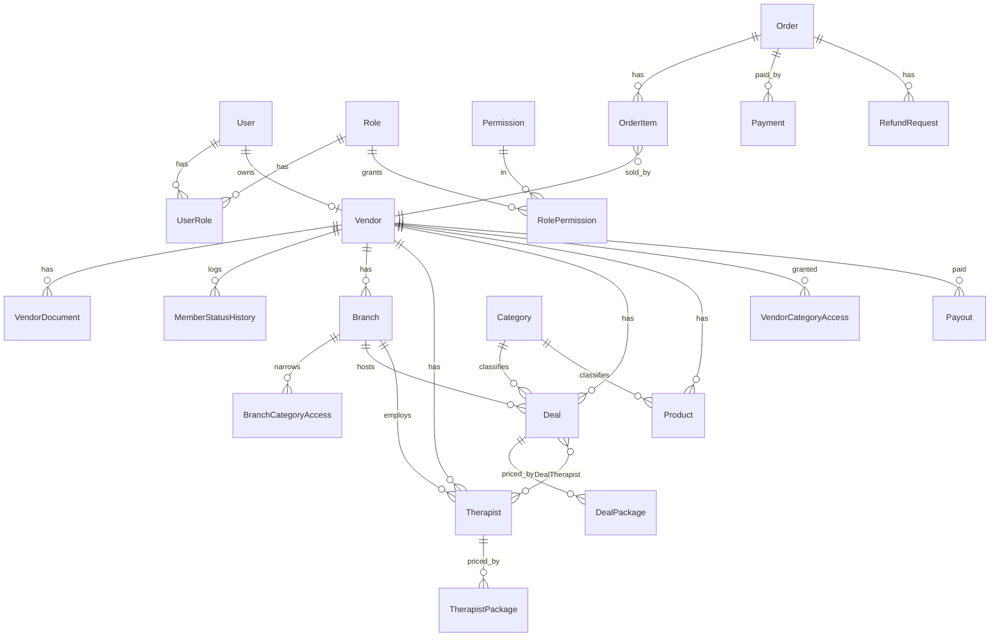

# MSD Admin RBAC and Member Catalog: Master Plan (single source of truth)

Version 3, 2026-10-14. Applies owner answers D7, D9, D10, D13, D18 (section 2.1). Replaces versions 1 and 2.
Scope: `apps/msd-api`, `packages/shared-{types,permissions,menu,auth}`, `apps/msd` admin console. `mera-driver*` untouched.
Business rules live in `ADMIN_USER_ROLES_AND_PERMISSIONS.md` and win any conflict on who can do what. Everything technical is here.

## 0. Document map

| File | Status |
|---|---|
| `ADMIN_USER_ROLES_AND_PERMISSIONS.md` | Keep. Business rules. |
| **`ADMIN_RBAC_MASTER_PLAN.md` (this file)** | Keep. Roles, resources, scope, DB, member catalog flow, endpoints, OpenAPI, validation, security, plan. |
| `ADMIN_RBAC_TASKS.md` | Keep. Task tracker. Corrections in section 13. |
| `DEAL_AND_PRODUCT_CONTENT.md` | Keep as raw seed content. Alignment and blockers in section 12. |
| `ADMIN_RBAC_BACKEND_SPEC.md`, `ADMIN_RBAC_API_DB_ENDPOINTS.md`, `ADMIN_RBAC_BACKEND_GAP.md`, `raj/*` duplicates, `DEAL_PRODUCT_DATA_MAPPING.md` | Superseded by this file. Deleted in the cleanup (section 14). |

Precedence: business role doc, then this file, then verified code facts (section 1).

---

## 1. Verified baseline

Checked on `feature/all-member-matrix-sandeep-5oct26` after the Raj merge (`git merge-base` confirms his branch is an ancestor).

| # | Fact | Evidence | Plan effect |
|---|---|---|---|
| F1 | `PermissionScope {ALL, OWN}` and `RolePermission.scope` **are now merged** (migration `20261008104219_add_permission_scope`, index on `scope`). `role.service` reads, writes and clones scope. | schema L14, L98; migration folder | Migration task is done. Enforcement is not. |
| F2 | Nothing enforces scope. `requirePermission`, `permission-resolver.service` and `bootstrap.service` have no scope code. `packages/shared-types` and `shared-permissions` have no scope type. | grep returns nothing | Whole authorization core is still to build. |
| F3 | Seed has 6 roles: `super_admin, admin, customer, vendor, marketing, sales`. No `support`. Role key `'vendor'` is hardcoded in `vendor.service.ts` L236. | seed.ts L38-43 | Add `support`, rename `vendor`. |
| F4 | Menu has 36 permission keys including `vendors`, `vendors.{branches,deals,products,therapists}`, and a second set `vendor-portal.{profile,branches,deals,products,therapists,customers,orders}`. `products` and `vendors.products` both point to `/account/products`. | `packages/shared-menu/src/msd-menu.json` | Collapse to 14 keys (section 3). |
| F5 | Every `/vendors/me/*` route is gated by one key, `vendors:custom`, not by resource. Admin-on-behalf routes use `vendors`, `vendors.branches`, `vendors.deals`, `vendors.therapists`, `vendors.products`. | `vendors.routes.ts` | Resource-level keys plus scope replace this. |
| F6 | Member can **delete own product** (`DELETE /vendors/me/products/:productId`). Business rule says members never delete. Admin-on-behalf delete exists for deals, therapists, products with `vendors.*:delete`. There is no delete route for branches. | `vendors.routes.ts` L1149, L1979, L2075, L2296 | Remove member delete; add branch delete for super_admin. |
| F7 | A member-created deal is stored `status=DRAFT, approvalStatus=PENDING` and a super admin must approve (`DEAL_PENDING_APPROVAL` notification). `setDealStatus` refuses ACTIVE until approved. Catalog visibility also requires `approvalStatus=APPROVED`. | `vendor.service.ts` L1458-1500, L1599, L726; `catalog.service.ts` | Remove the gate (owner decision D6 = yes). |
| F8 | `VendorStatus` has 7 values, `VendorDocument` has no status or number, `PaymentStatus` has 4 values, no `RefundRequest`, `Payout`, `SystemSetting`, `MemberStatusHistory`, `MemberDocumentReminder`, `IdempotencyKey`. `NotificationRecipientType` is `SUPERADMIN, VENDOR`; `NotificationType` has 3 values. | schema | New tables and enum values (section 4). |
| F9 | `UserStatus` is lowercase `active, inactive, blocked`. **`blocked` already exists.** | schema L1590 | No enum change for customer block. Only reason columns. |
| F10 | Status is modelled three ways: Branch, Therapist, Product use `isActive Boolean`; Deal uses `status DealStatus`; Vendor uses `VendorStatus`. | schema | Keep as is (no migration). Document it in section 4.2. |
| F11 | Hard delete is already guarded by foreign keys. `deleteDeal` and `deleteTherapist` catch Prisma `P2003` and return 409 "Deactivate it instead". `deletedAt` exists only on `User`. | `vendor.service.ts` L1626, L1072 | Drop the planned soft-delete columns. Reuse the 409 guard. |
| F12 | `app.ts` has `cors` and `express.json` (raw body capture), no `helmet`, no `trust proxy`, no body `limit`, no global rate limiter. `/docs` is always mounted. | `src/app.ts` L48-63 | Hardening tasks stand. |
| F13 | OpenAPI: built the real document (`buildOpenApiDocument()`) and compared with a scan of all `router.<verb>(...)` calls. **329 router routes, 248 documented operations, 82 routes undocumented.** Details in section 8. | script run 2026-10-14 | Coverage gap is real, not a guess. |
| F14 | `SupportRequest` (customer contact message) is unrelated to the `support` staff role. | schema L46 | Never reuse it for refunds. |
| F15 | Prisma client generates to `src/generated/prisma-client`; the OpenAPI document builds without a database. | `_cov2` run | `prisma validate`, `generate`, `tsc`, OpenAPI build and unit tests need no Postgres (section 14). |

Not re-verified (check when each task starts): order-item vendor filtering, KYC magic-byte check, Razorpay raw-body HMAC, audit helper swallowing errors, report route behavior.

---

## 2. Decisions

### 2.1 Owner answers recorded (2026-10-14)

| # | Question | Answer | How this plan applies it |
|---|---|---|---|
| D1 | Old `REJECTED` vendors | Yes, map to SUSPENDED | `PROFILE_INCOMPLETE, PENDING_VERIFICATION, APPROVED, ACTIVE` become ACTIVE; `REJECTED` becomes SUSPENDED with reason "Migrated from rejected". Print counts per old state before migrating. |
| D2 | Payout commission rule | "Go ahead as per plan" | Payout tables and endpoints are designed now, but the generation job needs a number. Commission is **1%** (D17), stored as `SystemSetting` key `payout.commissionPercent = 1`, applied to each member's gross. Cadence: monthly, previous calendar month, eligible orders `CONFIRMED` or `COMPLETED` and payment `PAID`, minus approved refunds. Rounded to 2 places, half-up. |
| D3 | Aadhaar and PAN storage | Store full for development, mask later if needed | Implemented as one switch. See 2.3. |
| D6 | Remove deal approval gate | Yes | See section 6.6. |
| D7 | When can a member be deleted | Super admin only, journey is inactive, then suspended, then delete | Delete is allowed only from `SUSPENDED` (state machine, section 5). Zero `OrderItem` rows means hard delete; otherwise the member is archived. |
| D9 | Member onboarding | Members are always created by staff, who share the login details; the member then completes profile, branches, deals, products, and views order history and customers | Public self-registration (`POST /vendors/me`) and `/me/submit` are removed (C-11). Member gets `V` on customers, own scope (matrix 3.4, C-16). |
| D10 | Category access | Categories and subcategories are created by staff and available to every member when creating deals | Per-member and per-branch category grants stop gating anything (C-12). Type rules stay: deal needs a `SERVICE` category, product `PRODUCT`, therapist specialization `THERAPY`. |
| D13 | Package label | Use the existing `DealPackage` (as seeded: duration plus price) | No `label` column. One deal holds duration and price options only; different services become separate deals (section 12). |
| D18 | Content authoring | All textual content is written in `sky-rich-text-editor` | Long text fields store sanitized HTML (C-15, sections 9 and 10). |
| D8 | Masters and dashboard access | Super admin VCED, admin VCE, **marketing V only** (no create or edit), others none; dashboard for all console roles with scoped data | Applied in 3.2 and the seed. |
| D11 | Refund policy | Yes to the recommendation | Partial refund allowed up to paid minus already refunded; payment must be `PAID` or `PARTIALLY_REFUNDED`; a reject needs a reason. |
| D12 | Support access to customer data | Yes to the recommendation | Support sees name, phone, email and order lines; never payment gateway ids. |
| D17 | Payout commission | 1% | See D2 row. |
| D19 | Member "my customers" view | Yes to the recommendation | Name, city, order count, last order date; no phone or email unless an order is open (C-16). |
| D20 | Rich text scope | Yes to the recommendation | Title, brand, badge, `shortDescription`, `summary`, benefits and howToUse items stay plain text; every long field is rich text (C-15). |
| D21 | Inactive and suspended behaviour (2026-10-15) | Inactive: member logs in and views orders, customers and own catalog, but cannot edit anything existing or add anything new. Suspended: no login, everything disappears from the website, and the member gets an email and SMS at the moment of suspension with the reason and how to return to active | Section 5 (status machine, `readOnly`, notification), tasks P2-04, P3-17, P3-18. |
| D22 | Support contact in member notices (2026-10-15) | Support contact is env vars until SystemSetting exists | `SUPPORT_EMAIL` and `SUPPORT_PHONE` in `apps/msd-api/src/config/env.ts`; task P3-20. Moves to `SystemSetting` keys with P8-02. |

### 2.2 Rules this plan sets

| # | Conflict | Decision |
|---|---|---|
| R1 | Business doc: 7 fixed roles. Architecture docs: custom roles. | **Fixed roles.** Role create, clone, delete return 403 `ROLE_MANAGEMENT_LOCKED`. Super admin may still edit grants. |
| R3 | `.strict()` everywhere vs breaking current clients. | New and changed routes strict from day one; existing routes switch per route once the msd frontend is confirmed clean. |
| R4 | Audit is best-effort today. | Status change, document review, refund, payout, delete and role-grant audit rows are written in the same transaction and fail the request if the write fails. |
| R5 | Customer block. | API accepts `active \| blocked`, maps to existing `UserStatus` (`active`, `blocked`). Add `statusReason`, `statusChangedAt`. No enum change. |
| R6 | Refund key. | Reuse `orders`: `orders:custom` raises, `orders:approve` decides. |
| R7 | Paths. | Canonical flat paths (`/members`, `/branches`, `/deals`, `/therapists`, `/products`). Current `/vendors/...` paths stay as deprecated aliases for one release. |
| R8 | Customer in console. | No RBAC grants. Self-service routes (`/orders/me`, cart, wishlist, `/customer/*`) stay authenticated-only. |
| R9 | Support. | `orders:custom` is its only extra. Documents: type and status only. |
| R10 | Several users per member. | Out of scope. One member, one owner user (`Vendor.ownerUserId @unique`). |
| R11 | Case convention of scope in API. | Use the DB values `ALL` and `OWN` in bootstrap (`scopes: Record<permissionKey, 'ALL'\|'OWN'>`). No translation layer. (Version 1 used lowercase.) |

### 2.3 Aadhaar and PAN handling (applies D3)

- Column `MemberDocument.documentNumber` stores the full value, **encrypted at rest** (AES-256-GCM, `FIELD_ENCRYPTION_KEY`). Plain text storage is not used even in development, because the cost is one helper and it removes the leak path through DB dumps and logs.
- API responses return `numberMasked` only (Aadhaar `XXXX XXXX 1234`, PAN `ABXXXXX34F`). Full value is never in a response, a log line or an audit `before/after`.
- Column `numberHash` (HMAC-SHA256 with `DOC_HASH_PEPPER`) enforces one number per member.
- Env switch `STORE_FULL_DOCUMENT_NUMBER` (default `true` in development). When `false`, only masked value and hash are written. Production boot logs a warning if it is `true`. Flip it later without a schema change.
- If you want plain, unencrypted storage instead, say so; I would not recommend it (DPDP exposure).

---

## 3. Roles, resources, actions (final)

### 3.1 Roles (7 system roles)

| Key | Name | Console | Notes |
|---|---|---|---|
| `super_admin` | Super Admin | Yes | `isSuperAdmin`, all permissions |
| `admin` | Admin | Yes | Same as super admin, no delete |
| `marketing` | Marketing | Yes | View catalog, manage content |
| `sales` | Sales | Yes | Creates members and their catalog |
| `member` | Member (was `vendor`) | Yes, own data | Never deletes |
| `support` | Support | Yes | View, raise refund request |
| `customer` | Customer | No | Storefront only |

### 3.2 Resources (14 permission keys)

Permission string stays `${menuKey}:${action}`. Every key needs a node in `msd-menu.json` or no permission row is generated.

| Key | Replaces |
|---|---|
| `members` | `vendors`, `vendors.group` |
| `branches` | `vendors.branches`, `vendor-portal.branches` |
| `deals` | `vendors.deals`, `vendor-portal.deals` |
| `therapists` | `vendors.therapists`, `vendor-portal.therapists` |
| `products` | `vendors.products`, `products`, `vendor-portal.products` |
| `orders` | `orders`, `vendor-portal.orders` |
| `customers` | `customers`, `customers.group`, `vendor-portal.customers` |
| `content` | all `cms.*` |
| `payments` | new |
| `reports` | `reports`, `reports.group` |
| `staff-users` | `rbac.users` (staff only) |
| `settings` | `settings`, `settings.group` |
| `logs` | `rbac.audit-logs`, login history |
| `profile` | `vendor-portal.profile` |
Kept outside the 14: `dashboard`, `masters.*` (categories, sub-categories, tags, popular-treatments, promotions, home-hero), `rbac.roles`. Masters are seeded as super_admin VCED, admin VCE, marketing V only, others none (owner decision D8). The role doc does not list them, so add them to its matrix when it is next edited.

### 3.3 Actions (no new kinds, existing 16)

| Business action | Permission | Roles |
|---|---|---|
| Member status (activate, deactivate, suspend) | `members:status_change` | super_admin, admin |
| Document approve / reject | `members:approve` / `members:reject` | super_admin, admin |
| Manual document reminder | `members:status_change` | super_admin, admin |
| Member delete | `members:delete` | super_admin |
| Order cancel | `orders:status_change` | super_admin, admin |
| Refund request raise | `orders:custom` | support, admin, super_admin |
| Refund approve / reject | `orders:approve` | super_admin, admin |
| Customer block / unblock | `customers:status_change` | super_admin, admin |
| Payout release | `payments:approve` | super_admin |
| Report export | `reports:export` | super_admin, admin |
| Pause or unpublish own branch, deal, therapist, product | `<res>:edit` (own) | member, and staff with edit |
| Upload media for a catalog item | `<res>:edit` | same as edit |

### 3.4 Seed matrix (V view, C create, E edit, D delete; scope A = ALL, O = OWN)

| Resource | super_admin | admin | marketing | sales | member | support |
|---|---|---|---|---|---|---|
| members | VCED A | VCE A | V A | VCE A | VE O | V A |
| branches | VCED A | VCE A | V A | VCE A | VCE O | V A |
| deals | VCED A | VCE A | V A | VCE A | VCE O | V A |
| therapists | VCED A | VCE A | V A | VCE A | VCE O | V A |
| products | VCED A | VCE A | V A | VCE A | VCE O | V A |
| orders | V A | V A | none | V A | V O | V A |
| customers | V A | V A | none | V A | V O (own customers only) | V A |
| content | VCED A | VCE A | VCE A | V A | none | V A |
| payments | V A | V A | none | none | V O | none |
| reports | V A | V A | none | none | V O | none |
| staff-users | VCED A | V A | none | none | none | none |
| settings | VE A | V A | none | none | none | none |
| logs | V A | V O | V O | V O | V O | V O |
| profile | VE O | VE O | VE O | VE O | VE O | VE O |

Extras in 3.3 are added on top, never beyond. Sales receives no status, approve, reject, export or delete.

### 3.5 Hard rules (enforced in code, not only in seed)

1. Member never deletes, anywhere (this removes `DELETE /vendors/me/products/:id`, F6).
2. Orders, payments, customers have no DELETE route.
3. `members:delete`, `payments:approve`, `staff-users:delete`, `settings:edit` and every `*:delete` on branches, deals, therapists, products are super_admin only. A grant edit cannot give them to another role (`ROLE_GRANT_FORBIDDEN`).
4. A grant edit cannot give scope ALL on `members, branches, deals, therapists, products, orders, payments, reports` to `member`.
5. OWN scope: a foreign record returns **404**. A caller-supplied `memberId` is ignored and replaced from the token.
6. Highest scope wins across several roles (ALL beats OWN).
7. Preview (impersonation) tokens are read-only: refused on payout, delete, status change, refund, staff-user and role-grant routes. A super_admin cannot be impersonated.

---

## 4. Database

Physical table names are kept (`@@map`). Every item is one reversible migration, written as reviewed SQL. Items needing a live database to apply are marked **needs Postgres** (section 14).

### 4.1 Validated key names and values (current code, 2026-10-14)

| Area | Current value in code | Target | Action |
|---|---|---|---|
| Role keys | `super_admin, admin, customer, vendor, marketing, sales` | `+ support`, `vendor` becomes `member` | Data migration, constants file |
| Permission actions | 16 lowercase: `view create edit delete export import approve reject upload download print assign restore permanent_delete status_change custom` | same | None |
| `PermissionScope` | `ALL, OWN` | same | None (merged) |
| `UserStatus` | `active, inactive, blocked` | same | Add reason columns only |
| `VendorStatus` | `PROFILE_INCOMPLETE, PENDING_VERIFICATION, APPROVED, REJECTED, ACTIVE, INACTIVE, SUSPENDED` | `MemberStatus {ACTIVE, INACTIVE, SUSPENDED, ARCHIVED}` | Expand then contract |
| `KycStatus` | `PENDING, VERIFIED, REJECTED` (vendor-level) | per-document status | Retire last |
| `VendorDocumentType` | `GST, PAN, AADHAAR` | same | None |
| `DealStatus` | `DRAFT, ACTIVE, INACTIVE, EXPIRED` | same | None |
| `DealApprovalStatus` | `PENDING, APPROVED, REJECTED` | unused after D6 | Keep column, stop reading it, drop in contract phase |
| Branch / Therapist / Product status | `isActive Boolean` | same | None |
| `OrderStatus` | `PENDING_PAYMENT, CONFIRMED, COMPLETED, CANCELLED` | same | None |
| `PaymentStatus` | `CREATED, PAID, FAILED, CANCELLED` | `+ REFUNDED, PARTIALLY_REFUNDED` | Enum add |
| `PaymentProvider` | `RAZORPAY, COD` | same | None |
| `NotificationRecipientType` | `SUPERADMIN, VENDOR` | `SUPERADMIN, ADMIN, MEMBER` | Enum rename and add |
| `NotificationType` | `DEAL_PENDING_APPROVAL, ORDER_RECEIVED, VENDOR_PENDING_APPROVAL` | add `DOCUMENT_*`, `MEMBER_SUSPENDED`, `REFUND_REQUESTED`, `PAYOUT_RELEASED`; stop emitting the two approval types | Enum add |
| `CategoryType` | `SERVICE, PRODUCT, THERAPY` | same | None |
| FK column name | `vendorId` on Branch, Therapist, Deal, Product, Order, OrderItem, VendorDocument | keep | Rename only in API and TypeScript, never the column |
| Case style | Mixed: lowercase `UserStatus`, `PermissionAction`; uppercase the rest | keep | Documented, no change |

### 4.2 Schema changes

| # | Item | Change | Notes |
|---|---|---|---|
| S1 | `Role` data | `vendor` to `member`, insert `support`; `lib/role-keys.ts` constants replace literals | Keep `UserRole` links. Seed twice must be a no-op. |
| S2 | `Permission` data | 14 keys plus kept keys; extend `permission-migration.service` to map old keys to new on existing grants | Old rows removed one release later |
| S3 | `RolePermission` backfill | Set `scope=OWN` for the member role on all member-owned resources | Default ALL would widen access once scope is enforced. Run before enforcement. |
| S4 | `Vendor` to `Member` | `enum MemberStatus`, columns `statusChangedAt, statusChangedByUserId, archivedAt, documentsDueAt, reviewFlaggedAt, welcomeSentAt`. `statusReason` exists. | **Done** (2026-10-15): migration `20261015100000_member_lifecycle`; apply after the backfill report sign-off (P10-45) |
| S5 | `VendorDocument` to `MemberDocument` | add `status {SUBMITTED, APPROVED, REJECTED, EXPIRED}` (Missing = no row), `documentNumber` (encrypted, see 2.3), `numberMasked`, `numberHash`, `rejectionReason, reviewedByUserId, reviewedAt, expiresAt, uploadedByUserId, uploadedOnBehalf`; index `(status, expiresAt)` | **Done** (2026-10-15): same migration; the encrypted number column is `numberEncrypted`. Migrated rows start SUBMITTED, never auto-approved |
| S6 | `MemberStatusHistory` | `id, memberId, fromStatus, toStatus, reason, actorUserId, createdAt`; index `(memberId, createdAt)` | Same transaction as the change |
| S7 | `MemberDocumentReminder` | `id, memberId, sequence 1..3, channel, missingTypes[], sentAt, status, providerRef`; unique `(memberId, sequence, channel)` | Makes cron idempotent |
| S8 | `RefundRequest` | `id, orderId, requestedByUserId, reason, amount Decimal(12,2), status REQUESTED\|APPROVED\|REJECTED\|REFUNDED\|FAILED, decidedByUserId, decidedAt, decisionNote, providerRefundId` | Cap computed under row lock |
| S9 | `Payout` | `id, memberId, periodStart, periodEnd, grossAmount, commissionAmount, netAmount, status PENDING\|RELEASED\|FAILED, releasedByUserId, releasedAt, reference`; unique `(memberId, periodStart, periodEnd)` | See D2 |
| S10 | `IdempotencyKey`, `ProviderEvent` | key table with 24 h TTL; `(provider, eventId)` unique | Refund, payout, webhook replay |
| S11 | `SystemSetting` | `key @id, value Json, updatedByUserId, updatedAt`; per-key Zod allowlist | No secrets stored |
| S12 | `User` | `statusReason`, `statusChangedAt` | R5 |
| S13 | (retired) | `DealPackage` is unchanged (D13) | |
| S14 | `Branch` | add `DELETE` route only. No column change. | Hard delete guarded by FK, see F11 |
| S15 | Indexes | `AuditLog(actorUserId, createdAt)`, `AuditLog(targetType, targetId)`, `LoginHistory(userId, createdAt)`, `Order(vendorId, createdAt)`, `OrderItem(vendorId)` | Check with EXPLAIN |
| S16 | `Notification` enums | as in 4.1 | |
| S17 | Bank fields | encrypt `bankAccountNumber` at rest, return masked | |

Dropped from version 1: soft-delete columns (F11), `PermissionScope` migration (F1), `BLOCKED` on `UserStatus` (F9), `DealPackage.label` (D13). `VendorCategoryAccess`, `BranchCategoryAccess`, `BranchSubcategoryAccess` stay as dormant tables and are dropped in the contract phase (D10).

### 4.3 Entity relations (as in code, with new tables)

### 4.4 Relation rules (service layer, not only FKs)

- `Deal.branchId` belongs to `Deal.vendorId` (derived server-side, never from the client).
- Every therapist on a deal shares the deal's branch and member (`assertTherapistsBelongToBranch`, exists).
- Deal category: an active top-level `SERVICE` category; the subcategory, when given, is an active child of it. No per-member or per-branch grant (D10).
- Therapist `specializationCategoryId`: an active `THERAPY` category or one of its children.
- Product category: an active top-level `PRODUCT` category; subcategory is its active child. No per-member grant (D10). Checked in `product.service.createProduct` and `updateProduct` (tasks C-07, C-12, P4-14).
- Member detail page (admin side) also shows total customers and total orders for the member as counts linking to the filtered lists (D9, task P10-49).
- One member, one owner user. Duplicate document number across members returns 409 `DOCUMENT_NUMBER_IN_USE`.

---

## 5. Authorization design

1. `requirePermission(menuKey, action)` resolves `{key, scope}` over all roles and sets `req.access = { scope: 'ALL'|'OWN', memberId? }` (`memberId` loaded from `Vendor.ownerUserId`).
2. `lib/scope.ts` `scopedWhere(req, resource)` is the only place that builds the ownership filter. Mapping: `vendorId` for branches, deals, therapists, products; `OrderItem.vendorId` for orders and payments; `ownerUserId` for members; `userId` for logs and profile.
3. `authenticate` loads member status for member-role users: `SUSPENDED` or `ARCHIVED` gives 403 `MEMBER_SUSPENDED`; `INACTIVE` sets `req.readOnly`. Staff and customers keep the current `User.status` rule.
4. `blockWhenReadOnly` on every non-GET except logout and token refresh (D21). `PATCH /me`, `PATCH /members/me`, document upload, media upload and every status toggle are blocked for an inactive member. GET routes stay open, so the member still sees orders, customers and own catalog. Error: 403 `MEMBER_INACTIVE_READ_ONLY`.
5. Roles are re-read from the database (30 s cache, cleared on role, grant, user-role and member-status change). Token `roles` is informational.
6. Suspend revokes all `RefreshSession` rows of the owner in the same transaction.
7. `GET /rbac/bootstrap` adds `scopes`; `shared-types` gets `PermissionScope` and `scopes`, `shared-permissions` gets `scopeFor()`.
8. Dashboard widgets and counts read through `scopedWhere`.

### Member status machine (any other transition returns 409)

| From | To | Who | Reason | Side effects |
|---|---|---|---|---|
| ACTIVE | INACTIVE | super_admin, admin | 10 to 500 chars | hidden from storefront, all writes blocked, login and reads allowed (D21) |
| ACTIVE, INACTIVE | SUSPENDED | super_admin, admin | 10 to 500 chars | revoke sessions, login refused, hidden, send email and SMS in the same request (normal path is inactive, then suspended) |
| INACTIVE, SUSPENDED | ACTIVE | super_admin, admin | 10 to 500 chars | restore as before, send "account active again" email and SMS |
| SUSPENDED | ARCHIVED | system, when a delete is requested and orders exist | n/a | hidden everywhere, rows kept |
| SUSPENDED | hard delete | super_admin only | 10 to 500 chars | only with zero `OrderItem` rows, else ARCHIVED. Delete from ACTIVE or INACTIVE returns 409 `MEMBER_NOT_SUSPENDED`. |

Suspension notice (D21): sent through the notification template service (P6-03) to the owner's email and phone, whichever exist, with `NotificationType.MEMBER_SUSPENDED`. It carries the suspension reason, the support email and phone, and the steps to return to active. Support contact values come from `SystemSetting` keys `support.email` and `support.phone`. A failed send is recorded and retried, and never rolls back the suspension. A login or OTP request by a suspended member returns 403 `MEMBER_SUSPENDED` with the same reason and steps, and no OTP is sent.

---

## 6. Member catalog flow: branches, deals, therapists, products

This section replaces `raj/member-branch-deal-therapist-product.md`, checked field by field against `schema.prisma` and `vendor.schema.ts`. Where Raj's draft differs from the code, the code name wins (column `vendorId`, not `member_id`).

### 6.1 Rules (business, from the role doc)

1. A member creates, edits, pauses or unpublishes own branches, deals, therapists and products. A member never deletes.
2. A deal belongs to exactly one branch. A therapist belongs to exactly one branch and may be assigned to several deals of that branch.
3. A product belongs to the member, not to a branch (`Product` has no `branchId`).
4. Sales and Admin create the same objects on behalf of a member. Super admin alone deletes.
5. The storefront shows an item only when member, branch and deal are all active. Branch, deal and therapist keep their own status, so reactivating a member restores everything.
6. A member with incomplete documents can still publish (documents are a follow-up, not a gate).

### 6.2 Creation order and prerequisites (all enforced today unless marked NEW)

| Step | Object | Prerequisite | Check |
|---|---|---|---|
| 0 | Member | Created by Sales or Admin only (User + Vendor), role `member` fixed server-side; staff share the login details; member then completes profile (D9) | exists; self-registration removed (C-11) |
| 1 | Categories | Staff already created categories and subcategories; they are open to every member (D10) | exists, grant checks removed (C-12) |
| 2 | Branch | `name` required; **`state` required (NEW, see 6.4)** | schema |
| 3 | Therapist | Branch exists; `specializationCategoryId` (optional) is a `THERAPY` category or its child | exists, grant check removed |
| 4 | Deal | Branch exists; category is `SERVICE`; at least one package; therapists (optional) share the branch | exists, grant checks removed |
| 5 | Product | Category is an active `PRODUCT` category (any, D10); optional subcategory, `isNew`, `isFeatured` | exists, grant check removed (P4-14) |

Inline therapist creation inside the deal request (Raj draft `inline_new_therapists`) is **not built and not planned**. The UI creates the therapist first (step 3) and then sends `therapistIds`. One transaction per object stays simple and keeps the existing `assertTherapistsBelongToBranch` check.

### 6.3 Object field tables (current API, validated)

Branch (`BranchCreate`, table `Branch`)

| Field | Type | Rule | Status |
|---|---|---|---|
| name | string | 1 to 150, required | exists |
| address, city, country | string | max 500 / 100 / 100 | exists |
| state | string | max 100, currently optional | **make required, allowlist (6.4)** |
| pincode | string | `^\d{6}$` or empty | exists |
| mapLocationUrl | url | resolved server-side to latitude and longitude; raw lat/lng stripped | exists |
| phone, email | string | max 30, email | exists (phone has no format rule; apply the Indian mobile rule) |
| openingHours | json | per weekday `{open, start, end}` HH:MM | exists |
| isActive | boolean | pause or unpublish via `PATCH .../status {isActive}` | exists |

Therapist (`TherapistCreate`, table `Therapist`, plus `TherapistPackage`)

| Field | Type | Rule |
|---|---|---|
| therapistType | string | 1 to 200, required (service label customers browse by) |
| personName | string | 1 to 200, required |
| gender | string | max 50, optional |
| specializationCategoryId | uuid | optional, `THERAPY` category the member holds |
| specialization | string | legacy free text, max 200 |
| bio | rich text (HTML) | max 2000 chars of plain text |
| experienceYears | int | 0 to 60 |
| photoUrl | url | legacy; real images via media endpoints |
| isActive | boolean | `PATCH .../status` |
| packages | child | `TherapistPackage {durationMinutes, sellingPrice, originalPrice?, isActive, sortOrder}`, unique `(therapistId, durationMinutes)`, `originalPrice >= sellingPrice` |

Deal (`DealCreate`, table `Deal`, plus `DealPackage`, `DealTherapist`)

| Field | Type | Rule |
|---|---|---|
| categoryId | uuid | required, `SERVICE` category in member and branch access |
| subcategoryId | uuid | optional, child of category, enabled on the branch |
| title | string | 1 to 200 |
| slug | string | lower-kebab, 2 to 160, globally unique, currently **required from client** |
| shortDescription | string | max 300 |
| description | rich text (HTML) | max 5000 chars of plain text |
| originalPrice, salePrice | decimal string | `^\d+(\.\d{1,2})?$`; synced from the cheapest active package |
| discountPercent | int | 0 to 100 (should be server-computed, 6.5) |
| durationMinutes | int | 1 to 1440; synced default |
| notes, policy, termsAndConditions | rich text (HTML) | max 5000 chars of plain text each |
| startDate, endDate | ISO datetime | optional |
| maxBookings, availableBookings | int | optional |
| packages | array | **at least 1**: `{id?, durationMinutes, sellingPrice, originalPrice?, isActive, sortOrder}`, unique `(dealId, durationMinutes)`; update replaces the full set by `id` diff |
| therapistIds | uuid[] | optional; on update, present replaces the set, absent leaves it |
| status | enum | `DRAFT, ACTIVE, INACTIVE, EXPIRED` via `PATCH .../status` |

Product (`ProductCreate`, table `Product`)

| Field | Type | Rule |
|---|---|---|
| name | string | 1 to 200 |
| slug | string | lower-kebab, globally unique, currently required from client |
| brand | string | max 150, plain label |
| categoryId, subcategoryId | uuid | category required |
| description | rich text (HTML) | max 5000 chars of plain text |
| summary | plain string | max 2000, used on cards and meta |
| benefits, howToUse | string[] | each max 300 |
| ingredients, returnPolicy | rich text (HTML) | max 3000 / 2000 chars of plain text |
| image, gallery, imageAlt | url / url[] / string | legacy; real images via media endpoints |
| badge | string | max 50 |
| price, originalPrice | decimal string | 2 places |
| discount | int | 0 to 100 (server-computed, 6.5) |
| isNew, isFeatured | boolean | Two checkboxes on the product form ("New", "Featured"), both default false |
| isActive | boolean | `PATCH .../status` |

Product form (member self-service and admin-on-behalf, same fields): the member picks Category (required, any active `PRODUCT` category, D10), then Subcategory and Type (optional children of the chosen category), and ticks "New" and "Featured" if they apply. The category list never depends on per-member grants: every active member can pick a category and subcategory by default, with no extra permission (owner confirmed 2026-10-16). Inactive members stay read-only (D21). Task P10-48.

Media for deal, therapist, product and member: images (`POST .../images`, delete, reorder, set primary) and one optional video, all under the same permission as edit.

### 6.4 Gaps between the code and the business flow

| # | Gap | Fix | Size |
|---|---|---|---|
| C-01 | Member can delete own product | Remove `DELETE /vendors/me/products/:id` (and the `DELETE /:id` canonical alias for non super_admin) | S |
| C-02 | Deal approval gate (F7) | D6 = yes: create stores `status=DRAFT`, `approvalStatus=APPROVED` for every actor; member publishes with `PATCH .../status ACTIVE`; stop `DEAL_PENDING_APPROVAL`; remove `approvalStatus` from `isDealPubliclyEligible`, `catalog.service`, `home-hero.service`, `promotion.service`; admin moderation is `deals:edit` setting `INACTIVE` with a reason; remove approve and reject routes and the frontend queue. Existing `PENDING` rows are set to `APPROVED` by data migration. | M |
| C-03 | `state` optional free text on Branch | Make required on create; validate against an allowlist of Indian states and union territories (`lib/india-states.ts`). Existing blank rows stay valid until edited. | S |
| C-04 | `slug` required from the client, globally unique | Make optional; generate from title with `lib/slug.ts` and a numeric suffix on conflict; keep 409 for explicit duplicates | S |
| C-05 | `discountPercent` and `discount` accepted from client | Compute from `originalPrice` and `salePrice`; ignore the client value | S |
| C-06 | Cross-resource permission model | Replace `vendors:custom` and `vendors.*` with `<resource>:<action>` plus scope (section 5) | L |
| C-07 | Product category check | Superseded by D10 and C-12. `createProduct` and `updateProduct` check only that the category is an active `PRODUCT` category and that the subcategory is its child; no per-member grant (done 2026-10-16, task P4-14) | S |
| C-08 | No branch delete | Add `DELETE /branches/:id`, `branches:delete`, super_admin only, 409 on FK conflict | S |
| C-09 | Canonical flat routes | Add `/branches`, `/deals`, `/therapists`, `/products` (6.5) over the existing services; nested routes become aliases | L |
| C-10 | (retired) | Package label not added (D13); `DealPackage` stays duration plus price | n/a |
| C-11 | Member self-registration and `/me/submit` | D9: remove `POST /vendors/me` and `POST /vendors/me/submit` (and the frontend self-signup and submit wizard). Keep `GET` and `PATCH /vendors/me`, media, documents. Member is created ACTIVE with `documentsDueAt` set. | M |
| C-12 | Category grants | D10: stop calling `assertVendorHasCategoryAccess`, `assertBranchHasCategoryAccess`, `assertBranchHasSubcategoryAccess` in deal, therapist and product create and update; keep type and parent-child checks; category pickers list all active categories of the right type; retire the `PUT .../category-access` routes (`/me`, `/:vendorId`, branch level) and the `offersService/offersProduct/offersTherapy` onboarding step; tables dropped in the contract phase | M |
| C-15 | Rich text storage (D18) | Fields in 6.3 marked rich text accept HTML from `sky-rich-text-editor`. Server sanitizes on write with an allowlist (section 9), derives a plain-text copy for search, meta description and JSON-LD, and measures length on the plain text. Storefront renders through a sanitizer, never raw. | M |
| C-16 | Member customers view | D9: member `GET /customers` with own scope (customers with an order item from the member), same DTO as today's `/vendors/me/customers` | S |
| C-13 | Member edits while INACTIVE | Enforced by `blockWhenReadOnly` (section 5) | S |
| C-14 | Phone format on Branch | Reuse the member phone rule | S |

### 6.5 Canonical endpoints for the catalog flow

All under `/api/v1`. Permission `<res>` is `branches`, `deals`, `therapists` or `products`. Scope OWN means the member's own rows; ALL means any. Staff pass `memberId` (create) or filter by it (list); under OWN it is ignored.

| Method and path | Permission | Replaces (current) | Notes |
|---|---|---|---|
| GET `/branches`, `/deals`, `/therapists`, `/products` | `<res>:view` | `/vendors/me/...`, `/vendors/:vendorId/...`, `/vendors/branches|deals|therapists`, `/products` | filters: `memberId` (ALL), `branchId`, `status`, `q`, page, sort allowlist |
| POST `/branches` | `branches:create` | `POST /vendors/me/branches`, `/vendors/:vendorId/branches` | `memberId` required under ALL |
| POST `/therapists` | `therapists:create` | `POST .../branches/:branchId/therapists` | body has `branchId` |
| POST `/deals` | `deals:create` | `POST .../branches/:branchId/deals` | body has `branchId`, `packages`, `therapistIds` |
| POST `/products` | `products:create` | `POST /vendors/me/products`, `/vendors/:vendorId/products` | |
| GET `/<res>/:id` | `<res>:view` | list then filter (no detail route today for some) | detail includes packages, therapists, media |
| PATCH `/<res>/:id` | `<res>:edit` | `PATCH .../:id` | allowlisted fields only |
| PATCH `/<res>/:id/status` | `<res>:edit` | `PATCH .../:id/status` | branch, therapist, product `{isActive}`; deal `{status}` |
| DELETE `/<res>/:id` | `<res>:delete` | `DELETE` routes (admin) and member product delete | super_admin only; 409 when orders or carts reference the row |
| PUT `/deals/:id/therapists` | `deals:edit` | `therapistIds` inside deal update | optional convenience; same branch check |
| CRUD `/therapists/:id/packages` | `therapists:edit` | `/vendors/me/therapists/:id/packages*` | |
| `/<res>/:id/images*`, `/<res>/:id/video` | `<res>:edit` | `/vendors/me/.../images*` and `/vendors/:vendorId/.../images*` | |
| PUT `/branches/:id/category-access` | `branches:edit` | `PUT .../category-access` | narrows member access |
| Old `/vendors/...` catalog paths | mapped | n/a | ALIAS, `Deprecation` header, usage log, removed one release later |

### 6.6 Visibility rule (after D6)

`publicVisibleWhere()` in `services/catalog-visibility.ts`: member `ACTIVE`, branch `isActive`, deal `status = ACTIVE`, deal date window valid, therapist `isActive` for therapist listings, product `isActive` and member `ACTIVE`. Every `/catalog` query uses it. `approvalStatus` is no longer read.

---

## 7. API catalog for the rest of RBAC

Legend: NEW, CHG (exists, change gate, scope or shape), KEEP, ALIAS (old path kept one release). Every route: `requirePermission`, `scopedWhere` where OWN is possible, strict Zod body, audit row on mutation, OpenAPI entry with `x-required-permission` and `x-scope`.

### 7.1 RBAC

| Route | Permission | Status | Change |
|---|---|---|---|
| GET `/rbac/bootstrap` | auth | CHG | add `scopes` |
| GET `/rbac/roles`, `/rbac/permissions/catalog`, `/rbac/roles/:id/permissions` | `rbac.roles:view` | KEEP | catalog lists the 14 keys |
| PUT `/rbac/roles/:id/permissions` | `rbac.roles:edit`, super_admin | CHG | rules 3 and 4 of 3.5 |
| GET, PUT `/rbac/roles/:id/widgets`, dashboard-widget routes | `rbac.roles` | KEEP | add `GET /rbac/roles/:id/widgets` to OpenAPI |
| POST `/rbac/roles`, POST `/rbac/roles/:id/clone`, DELETE `/rbac/roles/:id` | n/a | CHG | 403 `ROLE_MANAGEMENT_LOCKED` |
| POST `/rbac/impersonate` | `rbac.users:custom` | CHG | block super_admin target, read-only token |

### 7.2 Members and documents

| Route | Permission | Scope | Status |
|---|---|---|---|
| GET `/members` (`status`, `documents=incomplete`, `reviewFlag`, `q`, page, sort) | members:view | own = self | CHG (from GET `/vendors`) |
| POST `/members` | members:create | all | CHG (welcome SMS or email, role fixed) |
| GET, PATCH `/members/:id` | members:view / edit | own = self | CHG |
| PATCH `/members/:id/status` `{status, reason}` | members:status_change | all | CHG (replaces `/approve`, `/reject`, `/status`) |
| DELETE `/members/:id` `{reason}` | members:delete | all | CHG |
| GET `/members/:id/status-history`, `/members/:id/activity` | members:view | own = self | NEW |
| GET, PATCH `/members/me` | profile:view / edit | own | CHG (alias of `/vendors/me`) |
| GET `/members/:id/documents` | members:view | own = self; support type and status only | CHG |
| PUT `/members/:id/documents/:type` (multipart `file`, `number`) | members:edit | own = self; admin sets `uploadedOnBehalf` | CHG |
| DELETE `/members/:id/documents/:type` (SUBMITTED, REJECTED only) | members:edit | own = self | CHG |
| GET `/members/:id/documents/:type/download-url` | members:view, not support | own = self | NEW (5 min, attachment) |
| PATCH `/members/:id/documents/:type/review` `{decision, reason?}` | members:approve / reject | all | CHG (replaces `/kyc-review`) |
| POST `/members/:id/documents/reminders` | members:status_change | all | NEW |
| POST `/internal/jobs/document-reminders` (`x-cron-secret`) | secret | n/a | NEW, hidden from public docs |

### 7.3 Orders, refunds, customers

| Route | Permission | Scope | Status |
|---|---|---|---|
| GET `/orders`, `/orders/:id` | orders:view | own: own items only, foreign 404 | CHG |
| POST `/orders/:id/cancel` `{reason}` | orders:status_change | all | NEW (current `PATCH /orders/:id/status` stays for system and customer flows) |
| POST `/orders/:id/refund-requests` | orders:custom | all | NEW |
| GET `/refund-requests` | orders:view | all | NEW |
| POST `/refund-requests/:id/approve` (`Idempotency-Key`), `/reject` | orders:approve | all, not preview | NEW |
| GET `/customers`, `/customers/:id` | customers:view | all | KEEP |
| PATCH `/customers/:id/status` `{status: active\|blocked, reason}` | customers:status_change | all | CHG (route exists, undocumented in OpenAPI) |

### 7.4 Content, payments, reports

| Route | Permission | Scope | Status |
|---|---|---|---|
| Existing `cms.*` routes (blog, FAQ, pages, about, contact, careers, social) | `content:<action>` | all | CHG gate only |
| GET `/payments`, `/payouts`, `/payouts/:id` | payments:view | own | NEW |
| POST `/payouts/:id/release` (`Idempotency-Key`, step-up OTP) | payments:approve | all, not preview | NEW |
| GET `/reports/overview`, `/online-payment-waiting`, `/member-payouts`, `/deals`, `/therapists`, `/products` | reports:view | own forces member in the aggregate | NEW |
| GET `/reports/:type/export?format=csv` | reports:export | all | NEW |
| Current `/reports/summary`, `/vendor-wise`, `/branch-wise`, `/month-wise`, `/service-vs-product`, `/top-*`, `/payment-method` | reports:view | own | KEEP as alias until the new set covers the dashboard |
| GET `/dashboard/stats` | dashboard:view | own | CHG |

### 7.5 Staff, settings, logs, profile

| Route | Permission | Status | Rule |
|---|---|---|---|
| GET, POST `/staff-users`, GET, PATCH `/staff-users/:id` | staff-users:view / create / edit | CHG (from `/rbac/users*`) | role allowlist: super_admin, admin, marketing, sales, support |
| PATCH `/staff-users/:id/status` | staff-users:edit | CHG | not the last active super_admin |
| DELETE `/staff-users/:id` | staff-users:delete | CHG | soft (`User.deletedAt`), super_admin only |
| POST `/staff-users/:id/revoke-sessions`, `/reset-otp`, POST/DELETE `/staff-users/:id/roles/:roleId` | staff-users:edit | CHG | allowlist applies |
| GET `/settings`, PATCH `/settings/:key` | settings:view / edit | NEW | key allowlist, no secrets |
| GET `/logs/login-history`, GET `/logs/audit` | logs:view | CHG | all or own by grant |
| GET, PATCH `/me` | profile:view / edit | CHG (alias of `/rbac/users/me`) | name, phone, email, avatar; phone and email change via OTP |

---

## 8. OpenAPI

### 8.1 Measured state (2026-10-14)

`buildOpenApiDocument()` compared with every `router.<verb>(...)` call mounted in `app.ts`.

| Metric | Value |
|---|---|
| Router routes | 329 |
| Documented operations | 248 |
| Undocumented routes | **82** |

Undocumented by group: vendors 45 (self-service media and KYC, admin-on-behalf therapist and product media, KYC admin, branch and deal patch/status for `me`), popular-treatments 13, home-hero 8, promotions 10, support 2, wishlist 2, catalog 3, customers 1 (`PATCH /customers/:id/status`), rbac 1 (`GET /rbac/roles/:id/widgets`), customer dashboard 1, auth 1.

### 8.2 Contract changes

1. Split `registry.ts` (2,554 lines) into `openapi/paths/<domain>.ts`; the output must be identical on the first commit.
2. `envelope(schema)` helper: success `{ data, error: null, meta? }`, error `{ data: null, error: { code, message, details? } }`.
3. Shared components: `Error`, `Pagination`, `MemberStatus`, `DocumentStatus`, `DocumentType`, `PermissionScope`, `IdempotencyKey` header, standard 401, 403, 404, 409, 422, 429.
4. Per operation: `security: bearerAuth`, `x-required-permission`, `x-scope`. One route metadata object drives `requirePermission` and both extensions so they cannot drift.
5. New schemas: `MemberCreate, MemberUpdate, MemberStatusChange, MemberDetail, MemberDocument, DocumentUpload, DocumentReview, StatusHistoryItem, RefundRequest (+Create, Decision), Payout, PayoutRelease, ReportQuery, ReportOverview, StaffUserCreate, SystemSetting, LoginHistoryItem, AuditLogItem, Bootstrap (with scopes)`. Catalog schemas (`BranchCreate`, `TherapistCreate`, `DealCreate`, `ProductCreate`, package schemas) exist; add the `state` change and the rich text note.
6. Document the 82 missing routes. Hide `/internal/*`. Serve `/docs` only outside production or behind basic auth.
7. CI script `scripts/openapi-coverage.ts` (the comparison used above) fails on any undocumented route.
8. Generate a typed client for `apps/msd` from the spec.

---

## 9. Validation (Zod)

| Field | Rule |
|---|---|
| ids | UUID (all current id columns are `uuid()`) |
| body | `.strict()` on new and changed routes now; existing routes staged (R3) |
| phone | normalise, then `^\+91[6-9]\d{9}$` (exists for member phones; apply to branch) |
| email | RFC, max 254, lowercase |
| state | one of the allowlist (C-03) |
| pincode | `^\d{6}$` (exists) |
| PAN | uppercase, `^[A-Z]{5}\d{4}[A-Z]$` (exists) |
| GST | `^\d{2}[A-Z]{5}\d{4}[A-Z][1-9A-Z]Z[A-Z\d]$` (exists) plus state code 01 to 38 (NEW) |
| Aadhaar | 12 digits, first 2 to 9, Verhoeff (NEW) |
| IFSC | `^[A-Z]{4}0[A-Z0-9]{6}$` (NEW; today length only) |
| UPI | `^[a-zA-Z0-9._-]{2,256}@[a-zA-Z]{2,64}$` (NEW) |
| status / decision reason | trimmed, 10 to 500 chars (today: max 1000, no minimum, `VendorStatusUpdate`) |
| document file | one file, PDF/JPG/PNG, 5 MB, magic bytes (exists), `.pdf` ContentType fixed |
| prices | decimal string, 2 places, `originalPrice >= sellingPrice` (exists) |
| rich text | HTML allowlist: `p, br, strong, em, u, s, h2, h3, ul, ol, li, blockquote, a[href,rel,target]`; links `https:`, `http:`, `mailto:`, `tel:` only; no `img` inside deal and product text (media goes through the media endpoints); no inline style, class, script, iframe or event attributes; plain-text length limit as in 6.3 |
| pagination | `page >= 1`, `pageSize 1..100`, default 20 (exists) |
| sort | per-resource enum allowlist |
| dates | ISO 8601, `from <= to`, max 366 days |
| refund amount | `<= paid - alreadyRefunded`, under a row lock |

Business checks (409 or 422): status transitions, delete when referenced, therapist and deal share branch, category access, duplicate document number, last active super_admin.

---

## 10. Security requirements

**Access control**: server-side scope on every route; 404 on foreign records; strict schemas and allowlists against mass assignment; super_admin-only actions enforced in code and seed; route inventory test fails on any route without `requirePermission` unless on a public allowlist.

**Rich text (D18)**: sanitize on write in `lib/sanitize-html.ts` (allowlist in section 9) and again on render in `apps/msd` (DOMPurify). Today the storefront renders deal and product text as plain text and the only `dangerouslySetInnerHTML` is JSON-LD; rendering HTML makes stored XSS a new risk across members and customers. JSON-LD must use the derived plain text and escape `<` in the `JSON.stringify` output. Reuse the sanitize step the CMS blog editor already has if it fits.

**Documents and PII**: private R2 bucket (`R2_PRIVATE_BUCKET`), presigned GET 5 min with `Content-Disposition: attachment`, no storage key in responses, support gets type and status only, full Aadhaar and PAN encrypted and never returned or logged (2.3), request logger redacts `documentNumber, bankAccountNumber, otp, authorization`, malware scan decision (task P5-12), move existing public files to the private bucket (P5-04).

**Transport and hardening**: `helmet`, `trust proxy` 1 (Railway), `express.json({ limit: '100kb' })` with the raw-body `verify` kept and the webhook route given its own parser size, global rate limit plus limiters for upload, status change, payout, refund, export, download; production boot fails on `JWT_SECRET < 32`, `*` in CORS, or missing `R2_PRIVATE_BUCKET`, `DOC_HASH_PEPPER`, `FIELD_ENCRYPTION_KEY`, `CRON_SECRET`.

**Money**: `Idempotency-Key`, transaction plus row lock, replay returns the stored result; webhook event-id replay table.

**Audit**: dotted action constants (`member.status.changed`), before and after, reason, ip, user agent; mandatory writes transactional (R4); exports and downloads audited.

**Hygiene**: check the commented Neon URL in `apps/msd-api/.env.example` for a live password and rotate if real; gitleaks in CI; CSV cells starting `=`, `+`, `-`, `@` prefixed; `npm audit` gate.

---

## 11. Open decisions (remaining)

| # | Decision | Recommendation | Blocks |
|---|---|---|---|
| D4 | "Ready for suspension review" day | Day 35 (one week after warning 3) | reminders |
| D5 | Migrated document rows | SUBMITTED; re-upload resets APPROVED or REJECTED to SUBMITTED | documents |
| D14 | Scheduler | Railway cron calling the secured endpoint | reminders |
| D15 | Avatar | Reuse the existing media upload | `/me` |
| D16 | Alias window | One release, removal after 14 days of zero traffic | cleanup |

---

## 12. Seed content alignment (`DEAL_AND_PRODUCT_CONTENT.md`, 10 deals, 5 products)

Status of that file: draft, "pending TL approval", never inserted. Mapping to the real API:

| Content field | API field | Note |
|---|---|---|
| Category, Sub Category | `categoryId`, `subcategoryId` | Resolve by name through `GET /vendors/categories`; never hardcode ids |
| Title, Slug, Short Description, Description | `title`, `slug`, `shortDescription`, `description` | Slug auto-generated after C-04 |
| Notes, Policy, Terms and Conditions | `notes`, `policy`, `termsAndConditions` | Rich text HTML; bullet lists become `<ul><li>` |
| Packages (duration, price, original price) | `packages[]` `{durationMinutes, sellingPrice, originalPrice}` | As seeded today. Named options, visit counts and variants go in the rich text description or become separate deals |
| Therapist type and name | `therapistType`, `personName` | "Not listed" becomes a neutral name such as "Team therapist"; create therapist first |
| Product Name, Brand, Badge, Summary, Description, Ingredients, Return Policy | same names | exact match |
| Price, Original Price, Discount | `price`, `originalPrice`, `discount` | Discount is computed server-side |

Blockers found:

1. **Currency**: content is USD (`$42.50`). The app and API samples are INR. Convert before import; there is no currency column.
2. **Category type**: a deal needs a `SERVICE` category (`assertVendorHasCategoryAccess(..., 'SERVICE')`). Deals 1 and 10 use "Therapy", which is a `THERAPY` type used for therapist specialization. Place these under a service category or change the category.
3. **Same-duration packages** (resolved by D13): Deal 2 has two 60-minute options (body, foot). Unique `(dealId, durationMinutes)` rejects the second, so split it into two deals, one per service. Any option that differs by content rather than duration becomes its own deal.
4. **Provenance**: deals are copied from Groupon listings (names, "Groupon price", "My Stuff", "voucher"). Rewrite as original copy and remove marketplace wording before any production insert (D18, now with the rich text editor as the authoring tool).
5. **Mapping sample inconsistencies** in the earlier mapping doc: Deal 1 maps to a "Massage > Foot Massage" category in the sample response; prices (INR 799/999) differ from the content; the product response sample was malformed. Re-capture real responses after the changes above.
6. **Therapist ownership**: every `therapistIds` entry must belong to the same branch (422 otherwise). Seed order is member, branch, therapists, deals (with packages and therapist links), products.

Insert path: write a seed script that calls the service layer in that order inside a transaction per deal. Convert all long text to sanitized HTML first (C-15). Do not insert before the currency conversion, the category type fix (blocker 2) and the content rewrite (blocker 4).

---

## 13. Plan

`ADMIN_RBAC_TASKS.md` stays the tracker. Corrections to apply:

1. P1-01: done (migration merged). Replace with "backfill `scope=OWN` for member grants" (S3).
2. P2-15: matches R1; the UI hide is already P10-08.
3. P1-10: add rule 4 of 3.5 and `ROLE_GRANT_FORBIDDEN`.
4. P3-14 (soft delete columns): delete the task. Replace with C-08 branch delete and keep the existing FK 409 guard (F11).
5. P3-15: expand to C-02 (full approval removal, data migration for PENDING rows, frontend queue removal).
6. New tasks: C-01, C-03, C-04, C-05, C-07, C-11, C-12, C-14, C-15, C-16, `openapi-coverage` CI script, staged `.strict()` flag (R3), transactional audit helper (R4), `STORE_FULL_DOCUMENT_NUMBER` switch (2.3).
7. P0-01: answers recorded in 2.1; remaining questions are section 11.
8. P0-03: legal review becomes advisory (D3), not a blocker.
9. Recompute the progress table.
10. D21: add P3-17 (suspension email and SMS) and P3-18 (suspended login message); tighten P2-04 (no `/me` exception) and P10-22 (inactive view-only).

### Build order

| Step | Phase | Output | Gate |
|---|---|---|---|
| 1 | P0 | Section 11 reviewed (D4, D5, D14 to D16 have recommendations and are not blockers); Neon snapshot; baseline tests | Decisions signed |
| 2 | P1 | Roles, 14 keys, seed matrix, role-key constants, menu, scope backfill | Matrix snapshot test |
| 3 | P2 | `req.access`, `scopedWhere`, member-status gate, read-only, helmet and limits, env guards, idempotency, audit, encryption | Unit tests |
| 4 | C-phase | Catalog flow: C-01 to C-09, approval removal, flat routes, aliases | IDOR tests, storefront visibility test |
| 5 | P3 | Member rename, status machine, history | Suspend hides, reactivate restores |
| 6 | P4 | Own-scope retrofit on orders, reports, dashboard, logs | Route inventory green |
| 7 | P5, P6 | Documents, reminders, cron | Redaction and masking tests, double run sends once |
| 8 | P7 | Cancel, refunds, reports, export, payouts (commission 1%, D17) | Concurrency tests |
| 9 | P8, P9 | Staff, settings, logs, profile; OpenAPI split and coverage gate | Coverage script passes |
| 10 | P10 | Frontend per backend phase | Per-role Playwright suite |
| 11 | P11, P12 | Security review, rehearsal, UAT, release, alias removal | APPROVE, signed UAT |

Migration order (expand, then code, then contract): S1 to S3, S6, S7, S4, S5, S8 to S13, S15 to S17, backfills, then drop `kycStatus`, legacy GST, PAN, `kycDocuments`, `approvalStatus` last.

### Verification

- No Postgres needed: `npx prisma validate --schema=apps/msd-api/prisma/schema.prisma`, `prisma generate`, `npx nx run msd-api:lint`, `npx nx run msd-api:build`, unit tests that mock Prisma, OpenAPI build and coverage script.
- Postgres needed: `prisma migrate dev`, seed twice, the table-driven role x resource x action x own/other matrix test, IDOR tests (member A reads member B's branch gives 404), status machine, suspended login, read-only member, document masking, duplicate number, cron idempotency, refund and payout idempotency, storefront visibility, migration row-count rehearsal.
- Manual: log in as each of the 6 console roles and call one route per resource; 200, 403 and 404 must match section 3.4.
- Known pre-existing failures must not grow: msd `app.spec.tsx` (1), `otp.test.tsx` (2), mera-driver (12).

---

## 14. Local database and documentation cleanup

### 14.1 Local Postgres

You can proceed without it for design, code, lint, build and OpenAPI work. Install it before step 3 of the build order (anything that applies a migration or runs a database test).

Recommended: PostgreSQL 16 on Windows (installer or Docker Desktop), database `msd_dev`, `DATABASE_URL=postgresql://postgres:<password>@localhost:5432/msd_dev` in `apps/msd-api/.env.local`. Never point local work at the Neon production database. Then `prisma migrate deploy`, `prisma db seed`. Restore a Neon dump once (`pg_dump` then `pg_restore`) to rehearse the vendor to member data migration.

### 14.2 Document cleanup

Done (2026-10-14, tracked in git, recoverable): `docs/msd/ADMIN_RBAC_BACKEND_SPEC.md`, `ADMIN_RBAC_API_DB_ENDPOINTS.md`, `ADMIN_RBAC_BACKEND_GAP.md`, `DEAL_PRODUCT_DATA_MAPPING.md`, and the whole `docs/msd/raj/` folder (including `member-branch-deal-therapist-product.md`, merged into section 6).

Kept on purpose:

| Path | Decision |
|---|---|
| `docs/api-schema/msd/*` | **Keep** as the quick-view schema reference developers start from. It is out of date (header still says "No code exists yet", last edited July and September), so it needs a refresh, see 14.3 |
| `docs/mera-driver/*` | Out of scope for this work, not touched |
| `ARCHITECTURE.md`, `PLANNING.md`, `DEPLOYMENT.md`, `DEVELOPER_PROCESS.md`, `MSD_API_ENDPOINTS_SECURITY.md` (update its counts after OpenAPI work), `DEAL_AND_PRODUCT_CONTENT.md` | Keep |

Not yet decided (no action taken): `docs/superpowers/plans/*` and `docs/superpowers/specs/*` (13 files of history for shipped shell, category and vendor-branch work) and `docs/msd/MENU.md`.

### 14.3 Schema quick-view folder (`docs/api-schema/msd/`)

Goal: one place where a developer sees every entity, enum, endpoint and Zod schema name before changing it. Hand-written tables drift, as the current files show (they describe a "companies", "reviews" and "pricing plans" design that was never built). Recommended rule so it stays true:

1. Generate, do not hand-write: `openapi.json` from `buildOpenApiDocument()` and a Prisma-derived entity summary (`prisma-schema.md`) by a small script, run in CI and committed.
2. Keep one short hand-written `README.md` that explains conventions (envelope, pagination, auth, scope, error codes) and links to this master plan.
3. Move the existing 00 to 11 design files into `docs/api-schema/msd/archive/` with a banner "historical design, not the current contract", then delete them one by one as each is confirmed obsolete.

This is a follow-up task (about half a day); nothing is changed in that folder yet.
