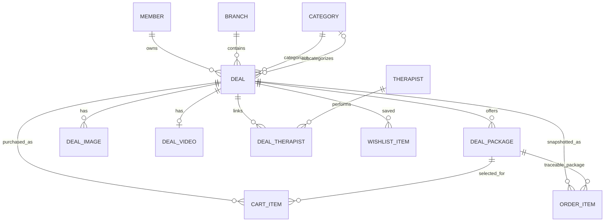
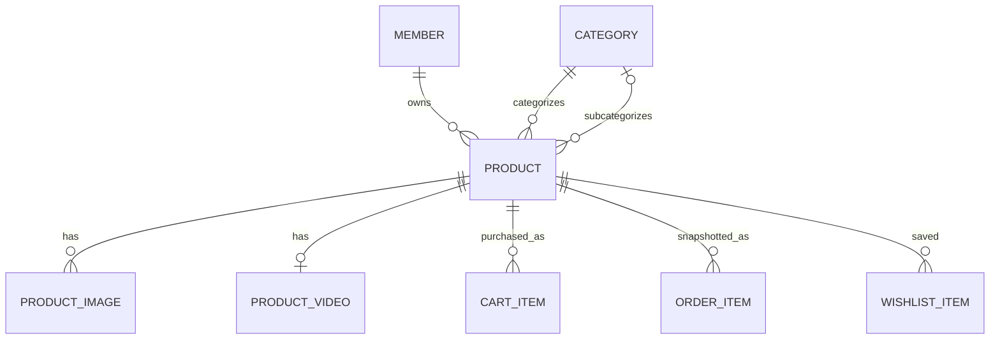

# Deal and Product Technical Documentation

**Project:** MSD (MySpaDeal)  
**Investigation date:** 2026-10-19  
**Scope:** Source-grounded documentation for admin create/edit and customer detail flows for
Deals and Products. This is documentation only; no application code, schema, or migration was
changed.

## 1. Executive summary

- A **Deal** is a member-owned, branch-bound service. Its selectable duration and price options
  are `DealPackage` rows; a Deal is not a wrapper around a Product. Customers add the selected
  package to cart.
- A **Product** is a separate member-owned, vendor-level retail item. It has no `branchId`,
  duration package, stock quantity, or inventory relation in the current schema. Customers add a
  Product directly to cart using the Product's current `price`.
- Both admin create/edit pages already exist under the member detail console. The Deal page edits
  packages and branch therapists; the Product page edits catalog and price fields. Neither form
  currently provides uploaded image/video management.
- Customer detail pages and public detail API endpoints exist. Deal detail uses a UUID id and
  displays active packages, deal/vendor/branch details, and media. Product detail also fetches by
  UUID and displays current price and media, but does not expose several existing Product fields
  (`benefits`, `howToUse`, `ingredients`, `returnPolicy`, `badge`) through the public response.
- Both Product and Deal wishlists are fully implemented end-to-end, with storage, APIs, and UI 
  controls active on their respective detail pages
- The current Product detail page renders an “In stock” message, but there is no Product stock
  field, inventory model, or stock check in the inspected Product/cart/checkout implementation.
- Current backend Deal approval behavior differs from the business rule in
  [`PLANNING.md`](PLANNING.md): member self-service creation sets `DRAFT`/`PENDING`, while the
  admin-on-behalf route used by the console form sets `ACTIVE`/`APPROVED`. Confirm the intended
  approval policy before changing behavior.

### Evidence labels

- **Verified:** directly observed in the current schema, route, service, or frontend implementation.
- **Gap:** the requested behavior is not present at the relevant implementation surface.
- **Confirmation needed:** multiple plausible business choices exist, or current implementation
  conflicts with the business planning document.

No field or behavior is inferred from a similarly named field alone.

## 2. Project structure and primary sources

| Concern | Source |
|---|---|
| Deal/Product Prisma models and enums | [`apps/msd-api/prisma/schema.prisma`](../../apps/msd-api/prisma/schema.prisma) |
| Deal request validation | [`apps/msd-api/src/schemas/vendor.schema.ts`](../../apps/msd-api/src/schemas/vendor.schema.ts) |
| Product request validation | [`apps/msd-api/src/schemas/product.schema.ts`](../../apps/msd-api/src/schemas/product.schema.ts) |
| Public catalogue validation and queries | [`apps/msd-api/src/schemas/catalog.schema.ts`](../../apps/msd-api/src/schemas/catalog.schema.ts), [`apps/msd-api/src/routes/catalog.routes.ts`](../../apps/msd-api/src/routes/catalog.routes.ts), [`apps/msd-api/src/services/catalog.service.ts`](../../apps/msd-api/src/services/catalog.service.ts), [`apps/msd-api/src/services/catalog-visibility.ts`](../../apps/msd-api/src/services/catalog-visibility.ts) |
| Admin/member Deal API | [`apps/msd-api/src/routes/vendors.routes.ts`](../../apps/msd-api/src/routes/vendors.routes.ts), [`apps/msd-api/src/services/vendor.service.ts`](../../apps/msd-api/src/services/vendor.service.ts) |
| Admin/member Product API | [`apps/msd-api/src/routes/vendors.routes.ts`](../../apps/msd-api/src/routes/vendors.routes.ts), [`apps/msd-api/src/routes/products.routes.ts`](../../apps/msd-api/src/routes/products.routes.ts), [`apps/msd-api/src/services/product.service.ts`](../../apps/msd-api/src/services/product.service.ts) |
| Cart, checkout and wishlist | [`apps/msd-api/src/schemas/cart.schema.ts`](../../apps/msd-api/src/schemas/cart.schema.ts), [`apps/msd-api/src/services/cart.service.ts`](../../apps/msd-api/src/services/cart.service.ts), [`apps/msd-api/src/services/order.service.ts`](../../apps/msd-api/src/services/order.service.ts), [`apps/msd-api/src/routes/wishlist.routes.ts`](../../apps/msd-api/src/routes/wishlist.routes.ts), [`apps/msd-api/src/services/wishlist.service.ts`](../../apps/msd-api/src/services/wishlist.service.ts) |
| Frontend route table | [`apps/msd/src/app/routes.tsx`](../../apps/msd/src/app/routes.tsx) |
| Admin Deal form | [`apps/msd/src/app/pages/account/members/deal-form-page.tsx`](../../apps/msd/src/app/pages/account/members/deal-form-page.tsx) |
| Admin Product form | [`apps/msd/src/app/pages/account/members/product-form-page.tsx`](../../apps/msd/src/app/pages/account/members/product-form-page.tsx) |
| Customer Deal detail | [`apps/msd/src/app/pages/deal-detail/deal-detail.tsx`](../../apps/msd/src/app/pages/deal-detail/deal-detail.tsx) |
| Customer Product detail | [`apps/msd/src/app/pages/product-detail/product-detail.tsx`](../../apps/msd/src/app/pages/product-detail/product-detail.tsx) |
| Frontend public API types/functions | [`apps/msd/src/api/catalog.ts`](../../apps/msd/src/api/catalog.ts) |
| Frontend admin API functions | [`apps/msd/src/api/rbac/vendors.ts`](../../apps/msd/src/api/rbac/vendors.ts) |
| Shared display media resolution | [`apps/msd/src/api/media.ts`](../../apps/msd/src/api/media.ts), [`apps/msd/src/utils/media.ts`](../../apps/msd/src/utils/media.ts) |
| Business scope and permission policy | [`PLANNING.md`](PLANNING.md), [`../ARCHITECTURE.md`](../ARCHITECTURE.md) |

The API mounts its routers below `/api/v1` in
[`apps/msd-api/src/app.ts`](../../apps/msd-api/src/app.ts). Successful HTTP responses use the
`{ data, error: null, meta? }` envelope. Public `/catalog/*` routes are unauthenticated; admin,
member, cart, order, and wishlist routes require a valid authenticated token.

## 3. Database schema

### 3.1 Deal

Prisma model/table: `Deal` (no `@@map`). `String @default(uuid())` identifiers are UUID-shaped
strings stored as PostgreSQL text. Decimal fields use `DECIMAL(10,2)` and `images` is JSONB.

| Field | Prisma / DB type | Required, default, constraint | Verified meaning / use |
|---|---|---|---|
| `id` | `String` / text | Required, `uuid()`, primary key | Deal identifier. |
| `vendorId` | `String` / text | Required, FK to `Member.id`, indexed; cascade on member deletion | Owning Member. |
| `branchId` | `String` / text | Required, FK to `Branch.id`, indexed; cascade on branch deletion | Exactly one branch; service derives ownership and checks it belongs to the same member. |
| `categoryId` | `String` / text | Required, FK to `Category.id` | Top-level service category. Backend validates active `SERVICE` category and branch/category access. |
| `subcategoryId` | `String?` / text nullable | Optional FK to `Category.id`; database `SET NULL` | Optional child category (category service permits a child or type-tier grandchild). |
| `title` | `String` / text | Required | Customer-facing title. |
| `slug` | `String` / text | Required, globally unique | Stored identifier/URL slug; public detail lookup currently uses `id`, not slug. |
| `shortDescription` | `String?` / text | Optional | Short catalog copy. |
| `description` | `String?` / text | Optional | Deal detail copy. Sanitization policy for this field was not independently verified in this trace. |
| `originalPrice` | `Decimal` / `DECIMAL(10,2)` | Required | Synced display cache from cheapest active package. |
| `salePrice` | `Decimal` / `DECIMAL(10,2)` | Required | Synced “from price” display/sort/filter cache. Cart pricing uses the selected package instead. |
| `discountPercent` | `Int?` / integer | Optional | Display/sort percentage; no verified automatic computation in the inspected Deal service. |
| `termsAndConditions` | `String?` / text | Optional | Displayed on Deal detail when present. |
| `images` | `Json?` / JSONB | Optional | Legacy hosted-URL array; new media system is the preferred source. |
| `maxBookings` | `Int?` / integer | Optional | Booking count limit field. Enforcement in the current cart/checkout path was not verified. |
| `availableBookings` | `Int?` / integer | Optional | Availability count field. Enforcement in the current cart/checkout path was not verified. |
| `startDate` | `DateTime?` / timestamp | Optional | Deal start-window field; public visibility implementation inspected here does not itself include date predicates. |
| `endDate` | `DateTime?` / timestamp | Optional | Deal end-window field; public visibility implementation inspected here does not itself include date predicates. |
| `status` | `DealStatus` / enum | Required, `DRAFT` | Enum: `DRAFT`, `ACTIVE`, `INACTIVE`, `EXPIRED`. |
| `approvalStatus` | `DealApprovalStatus` / enum | Required, `PENDING` | Enum: `PENDING`, `APPROVED`, `REJECTED`; public visibility requires `APPROVED`. |
| `approvalRejectionReason` | `String?` / text | Optional | Rejection details. |
| `durationMinutes` | `Int?` / integer | Optional at DB level | Legacy/default-duration display cache synced from the cheapest active package. |
| `notes` | `String?` / text | Optional | Deal detail information when present. |
| `policy` | `String?` / text | Optional | Deal detail information when present. |
| `createdAt` | `DateTime` / timestamp | Required, `now()` | Creation timestamp. |
| `updatedAt` | `DateTime` / timestamp | Required, `@updatedAt` | Last update timestamp. |

Indexes: `vendorId`, `branchId`, `status`; `slug` has a unique constraint. Deal has no explicit
physical table mapping.

### 3.2 Deal child models

| Model/table | Fields and constraints | Relations and deletion |
|---|---|---|
| `DealPackage` | `id` UUID string PK; `dealId` required; `durationMinutes` integer; `sellingPrice DECIMAL(10,2)`; `originalPrice DECIMAL(10,2)?`; `isActive` boolean default `true`; `sortOrder` integer default `0`; `createdAt` default now; `updatedAt` auto-updated. Unique `(dealId, durationMinutes)`; index `dealId`. | Many packages per Deal; FK cascades on Deal deletion. Cart/order references are nullable and set null when the package is deleted. |
| `DealImage` | `id`, `dealId`, required `storageKey`, `mimeType`, `sizeBytes`; optional `originalFilename`; `sortOrder` default `0`; `isPrimary` default `false`; timestamps. Index `dealId`. | One Deal to many image rows; cascade on Deal deletion. A partial unique DB index permits at most one primary image per Deal. |
| `DealVideo` | `id`, unique `dealId`, required `storageKey`, `mimeType`, `sizeBytes`; optional `originalFilename`; timestamps. | One-to-zero-or-one Deal video; cascade on Deal deletion. |
| `DealTherapist` | `id`, `dealId`, `therapistId`, `createdAt`; unique `(dealId, therapistId)`; indexes on both FK columns. | Explicit many-to-many link. Both FKs cascade on deletion. Service checks that linked therapist and Deal share vendor and branch; that rule is not a DB constraint. |

The Deal package table is the customer-selectable duration/price source. The Deal-level
`durationMinutes`, `salePrice`, and `originalPrice` are synchronized from the cheapest active
package to preserve existing listing/filter behavior; they are not authoritative for cart
pricing.

### 3.3 Product

Prisma model/table: `Product` (no `@@map`). There is no `branchId` and no stock/inventory field.
`brand` is text, not a related model.

| Field | Prisma / DB type | Required, default, constraint | Verified meaning / use |
|---|---|---|---|
| `id` | `String` / text | Required, `uuid()`, primary key | Product identifier. |
| `name` | `String` / text | Required | Customer-facing product name. |
| `slug` | `String` / text | Required, globally unique | Stored slug; public detail currently resolves by UUID id, not slug. |
| `brand` | `String?` / text | Optional | Plain brand label. |
| `categoryId` | `String` / text | Required, FK to `Category.id`, indexed | Product category; backend requires an active top-level `PRODUCT` category. |
| `subcategoryId` | `String?` / text | Optional FK to `Category.id`; `SET NULL` | Optional child category/type node; backend checks it belongs below `categoryId`. |
| `description` | `String?` / text | Optional | Product description. |
| `summary` | `String?` / text | Optional | Short description fallback in detail UI. |
| `benefits` | `Json?` / JSONB | Optional | Schema comment identifies a string array; not exposed in public Product select or current form. |
| `howToUse` | `Json?` / JSONB | Optional | Schema comment identifies a string array; not exposed in public Product select or current form. |
| `ingredients` | `String?` / text | Optional | Present in schema and admin form; not exposed by public Product detail API. |
| `returnPolicy` | `String?` / text | Optional | Present in schema and admin form; not exposed by public Product detail API. |
| `image` | `String?` / text | Optional | Legacy single hosted URL. |
| `gallery` | `Json?` / JSONB | Optional | Legacy array of hosted image URLs. |
| `imageAlt` | `String?` / text | Optional | Legacy image alternative text; public select includes this field. |
| `badge` | `String?` / text | Optional | Present in schema/admin form; not included in public Product select. |
| `price` | `Decimal` / `DECIMAL(10,2)` | Required | Directly purchasable Product price. |
| `originalPrice` | `Decimal?` / `DECIMAL(10,2)` | Optional | Optional comparison price. |
| `discount` | `Int?` / integer | Optional | Percentage field; validation is integer 0–100. The service does not derive it from prices. |
| `isNew` | `Boolean` / boolean | Required, `false` | Catalog flag. |
| `isFeatured` | `Boolean` / boolean | Required, `false` | Catalog flag. |
| `isActive` | `Boolean` / boolean | Required, `true` | Product activation and public availability flag. |
| `vendorId` | `String` / text | Required, FK to `Member.id`, indexed; cascade on member deletion | Owning Member. |
| `createdAt` | `DateTime` / timestamp | Required, `now()` | Creation timestamp. |
| `updatedAt` | `DateTime` / timestamp | Required, `@updatedAt` | Last update timestamp. |

Unique/index constraints: unique `slug`; indexes on `categoryId` and `vendorId`. Product has no
inventory relation or database field for SKU, quantity, stock-on-hand, or branch-specific stock.

### 3.4 Product child models

| Model/table | Fields and constraints | Relations and deletion |
|---|---|---|
| `ProductImage` | `id`, `productId`, required `storageKey`, `mimeType`, `sizeBytes`; optional `originalFilename`; `sortOrder` default `0`; `isPrimary` default `false`; timestamps; index `productId`. | Many images per Product; cascade on Product deletion. Partial unique DB index limits each Product to one primary image. |
| `ProductVideo` | `id`, unique `productId`, required `storageKey`, `mimeType`, `sizeBytes`; optional `originalFilename`; timestamps. | One-to-zero-or-one Product video; cascade on Product deletion. |

### 3.5 Related models in the lifecycle

- **Member (`Member`, physical table `Vendor`):** Deal and Product each belong to one Member. A Member
  must be `ACTIVE` to make its catalog items publicly visible. The Product has no branch field.
- **Branch:** one branch has many Deals. Deal `branchId` must belong to its `vendorId`; branch must
  be active for public Deal visibility. Product does not point to Branch.
- **Category:** Deal references `SERVICE`; Product references `PRODUCT`. Both can optionally
  reference a child category. Category activation and parent/child validity are checked by
  backend service logic.
- **Therapist:** Deals can link multiple Therapists with `DealTherapist`; service code validates
  the linked therapists are at the Deal's branch and Member. Public Deal selection does not
  currently include the therapist links.
- **Cart / CartItem:** a customer has one Cart; a Cart has many CartItems. A Deal line has
  `dealId + dealPackageId`; a Product line has only `productId`. The schema comment describes
  these as mutually exclusive shapes, but the database does not enforce the exactly-one invariant;
  request Zod validation and cart service enforce it.
- **Order / OrderItem:** checkout makes OrderItems with snapshotted price, item name, quantity,
  vendor name, and (for service lines) branch/duration data. Product lines have no branch. Order
  data is not re-read from live Product/Deal to display historical purchase values.
- **WishlistItem:** supports either `dealId` or `productId`, with unique customer/entity pairs.
  Deal visibility is rechecked when listing; Products are included only while active.

### 3.6 ER diagrams (verified relations only)





`CATEGORY o|--o{ DEAL/PRODUCT` denotes the optional subcategory reference; each entity still
requires its primary category. Mermaid is a conceptual diagram and omits scalar FK/index details,
which are in the field tables above.

### 3.7 Migration lineage relevant to these entities

The schema file remains authoritative. The following migrations were inspected or matched to the
current models and show the major evolution relevant to page behavior:

| Migration | Relevant change |
|---|---|
| `20260810112617_add_vendor_branch_deal` | Initial branch/member Deal catalog tables and relations. |
| `20260811075729_add_product` | Initial Product table fields, unique slug, category relations/index. |
| `20260811092848_deal_service_product_offering` | Earlier Deal service/product references and duration; later architecture removed Deal-to-Product coupling. |
| `20260819090000_deal_packages` | Adds DealPackage and package traceability to legacy booking/order structures. |
| `20260819100000_add_media_tables` | Adds per-entity image/video tables for Deal, Product, Therapist, including partial unique primary-image indexes. |
| `20260902090000_remove_booking_model` | Removes the separate Booking model; cart/order flow is the current purchase path. |
| `20260827130000_direct_category_access` | Moves catalog authorization toward direct category access; current validation checks category type and branch access. |
| `20260910091537_archive_legacy_product_deals` | Archives legacy Product/Deal data during the catalog separation. |
| `20260910091757_decouple_product_from_deal` | Separates Product from Deal and establishes the independent Product lifecycle. |
| `20261004223414_add_deal_therapist_link` | Adds DealTherapist many-to-many table; preserves order-item Deal FK with set-null deletion behavior. |
| `20261007070650_add_product_to_wishlist` | Adds nullable `WishlistItem.productId` and unique customer/Product constraint. |

## 4. API reference

### 4.1 Public Deal catalogue

All routes are public (no `authenticate` or `requirePermission` on the catalog router).

| Method and full path | Purpose / query and path validation | Result / behavior |
|---|---|---|
| `GET /api/v1/catalog/deals` | Paginated list. Optional UUID `categoryId`, `subcategoryId`, `vendorId`, `branchId`; comma-separated UUID lists `vendorIds`/`branchIds` (up to 50); `search` max 200; `state`, `city` max 100; `sort` = `relevance`, `price_asc`, `price_desc`, `distance`, `newest`, `discount`; `radiusKm` >0 to 500; `minPrice`, `maxPrice` >=0; `latitude` -90..90; `longitude` -180..180. Pagination uses shared `PaginationQuerySchema`. | `{ data: Deal[], error: null, meta: { total, page, pageSize } }`. Location sorting/radius uses branch coordinates only when both caller coordinates are provided. |
| `GET /api/v1/catalog/deals/facets` | Deal facet filters, omitting paging/sort and single vendor/branch IDs. Route is registered before `/:id`. | `{ data: { vendors, branches, distance, price }, error: null }`; counts are derived from current filters. |
| `GET /api/v1/catalog/deals/:id` | UUID path parameter. | One customer-visible Deal or 404. Includes active packages, category/subcategory, limited vendor/branch data, media, and popular tags. |

Public visibility uses `status = ACTIVE`, `approvalStatus = APPROVED`, active Member and active
Branch. Unavailable/invisible records are returned as 404 by the single-item endpoint. The public
Deal select does not include every database field: for example, it does not expose approval
metadata, booking counters, or `therapistLinks`.

### 4.2 Admin/member Deal APIs

Paths below are mounted under `/api/v1/vendors`.

| Method and full path | Guard | Purpose |
|---|---|---|
| `GET /api/v1/vendors/:vendorId/deals` | `vendors.deals:view` | Admin cross-branch listing for a Member; used by the Deal edit form to find the selected Deal. |
| `GET /api/v1/vendors/:vendorId/branches/:branchId/deals` | `vendors.deals:view` | List a branch's Deals. |
| `POST /api/v1/vendors/:vendorId/branches/:branchId/deals` | `vendors.deals:create` | Admin/staff creates on behalf of a Member. |
| `PATCH /api/v1/vendors/:vendorId/branches/:branchId/deals/:dealId` | `vendors.deals:edit` | Admin/staff updates Deal fields, packages, therapist links. |
| `PATCH /api/v1/vendors/:vendorId/branches/:branchId/deals/:dealId/status` | `vendors.deals:status_change` | Updates Deal status. |
| `PATCH /api/v1/vendors/:vendorId/branches/:branchId/deals/:dealId/approve` | `vendors.deals:approve` | Approves a Deal. |
| `PATCH /api/v1/vendors/:vendorId/branches/:branchId/deals/:dealId/reject` | `vendors.deals:reject` | Rejects a Deal; body `{ rejectionReason }`. |
| `DELETE /api/v1/vendors/:vendorId/branches/:branchId/deals/:dealId` | `vendors.deals:delete` | Hard-delete endpoint. Referential and order-history effects should be confirmed before relying on this operation. |
| `GET /api/v1/vendors/me/branches/:branchId/deals` | `members:custom` | Member self-service list. |
| `POST /api/v1/vendors/me/branches/:branchId/deals` | `members:custom` | Member self-service create. |
| `PATCH /api/v1/vendors/me/branches/:branchId/deals/:dealId` | `members:custom` | Member self-service update. |
| `PATCH /api/v1/vendors/me/branches/:branchId/deals/:dealId/status` | `members:custom` | Member self-service status update. |

There is no single-Deal admin GET in this route group. The current admin form loads the Member's
Deal list and finds the row locally. Self-service Deal image/video upload routes exist under
`/vendors/me/branches/...`; the inspected admin-on-behalf routes do not provide equivalent Deal
media routes.

### 4.3 Public Product catalogue

| Method and full path | Purpose / query and path validation | Result / behavior |
|---|---|---|
| `GET /api/v1/catalog/products` | Public paginated list. Optional UUID `categoryId`, `subcategoryId`, `vendorId`; `search` max 200; `sort` = `relevance`, `price_asc`, `price_desc`, `newest`, `discount`; optional `minPrice`/`maxPrice` >=0. | `{ data: Product[], error: null, meta: { total, page, pageSize } }`. Relevance/newest use `createdAt desc`; price sorts use `Product.price`; discount sorts by `discount`. |
| `GET /api/v1/catalog/products/:id` | UUID path parameter. | One customer-visible Product or 404. Product must be active and its Member active. |

`PUBLIC_PRODUCT_SELECT` includes `id`, `name`, `slug`, `brand`, `description`, `summary`, legacy
`image` and `imageAlt`, `price`, `originalPrice`, `discount`, `category`, `subcategory`, limited
`vendor`, `mediaImages`, and `mediaVideo`. `popularTags` are attached by service logic. It does
**not** include `benefits`, `howToUse`, `ingredients`, `returnPolicy`, `badge`, `isNew`, or
`isFeatured`.

### 4.4 Admin/member Product APIs

Paths below are mounted under `/api/v1/vendors`, except the cross-vendor oversight GETs under
`/api/v1/products`.

| Method and full path | Guard | Purpose |
|---|---|---|
| `GET /api/v1/vendors/:vendorId/products` | `vendors.products:view` | Admin/member-scoped list. Query supports page/pageSize, `search`, optional `categoryId`, `subcategoryId`, `status` (`active`/`inactive`). |
| `POST /api/v1/vendors/:vendorId/products` | `vendors.products:create` | Admin/staff creates on behalf of a Member. `vendorId` is taken from the URL, not body. |
| `PATCH /api/v1/vendors/:vendorId/products/:productId` | `vendors.products:edit` | Admin/staff update. |
| `PATCH /api/v1/vendors/:vendorId/products/:productId/status` | `vendors.products:edit` | Admin/staff sets `{ isActive: boolean }`. |
| `DELETE /api/v1/vendors/:vendorId/products/:productId` | `vendors.products:delete` | Admin/staff hard delete. |
| `GET /api/v1/vendors/me/products` | `members:custom` | Member self-service Product list, implicitly scoped to the current Member. |
| `POST /api/v1/vendors/me/products` | `members:custom` | Member self-service create. |
| `PATCH /api/v1/vendors/me/products/:productId` | `members:custom` | Member self-service update. |
| `PATCH /api/v1/vendors/me/products/:productId/status` | `members:custom` | Member self-service status update. |
| `DELETE /api/v1/vendors/me/products/:productId` | `members:custom` | Member self-service hard delete currently exists. This conflicts with the “Members never delete” rule in `PLANNING.md` §1.3. |
| `GET /api/v1/products` | `products:view` | Authenticated cross-vendor oversight list; Member owners are force-scoped to their own Member. |
| `GET /api/v1/products/:id` | `products:view` | Oversight single Product; Member owners are force-scoped. The admin form does not use this endpoint. |

Product image/video media endpoints exist for both `/vendors/me/products/:productId/...` and
`/vendors/:vendorId/products/:productId/...`. Admin-on-behalf media routes use
`vendors.products:edit`; self-service routes use `members:custom`.

### 4.5 Deal and Product request rules

**Deal create/update fields** (`DealFieldsSchema`, `DealCreateSchema`, `DealUpdateSchema`):

| Field | Validation / behavior |
|---|---|
| `categoryId` | Required UUID on create; category is validated by service as active `SERVICE` type and branch-authorized. |
| `subcategoryId` | Optional UUID; validated as a child or grandchild under `categoryId` and branch-authorized. |
| `title` | Required string, 1–200 characters. |
| `slug` | Required lower-kebab-case string, 2–160 characters; globally unique, conflict returns 409. |
| `shortDescription` | Optional, max 300 characters. |
| `description`, `termsAndConditions`, `notes`, `policy` | Optional, each max 5,000 characters. |
| `originalPrice`, `salePrice` | Required decimal strings, plain non-negative number text with up to 2 fractional digits. Deal price cache is then synced from package pricing. |
| `discountPercent` | Optional integer 0–100; no verified server-side recomputation. |
| `durationMinutes` | Optional in Zod/DB, integer 1–1,440 when supplied; service requires duration for service Deals. |
| `images` | Optional array of valid URLs (legacy field); current media tables are separate. |
| `maxBookings`, `availableBookings` | Optional integers >=0; no cart enforcement verified. |
| `startDate`, `endDate` | Optional ISO datetime strings; no Deal-specific date order refinement found in this schema. |
| `therapistIds` | Optional array of UUIDs; service checks same Member and branch. Update omission leaves links unchanged; a supplied array replaces the existing set. |
| `packages` | Create requires at least one package. Update omitting the field preserves existing packages; a supplied array replaces the set and must remain non-empty. Duration positive integer; selling/original prices numeric and >=0; original must be >= selling; `isActive` optional boolean; `sortOrder` optional integer >=0. Unique duration per Deal. |

**Product create/update fields** (`ProductCreateSchema`, `ProductUpdateSchema`):

| Field | Validation |
|---|---|
| `name` | Required string, 1–200 characters. |
| `slug` | Required lower-kebab-case string, 2–160 characters; globally unique. |
| `categoryId` | Required UUID on create; must resolve to active top-level `PRODUCT` category. |
| `subcategoryId` | Optional UUID; service validates it under the selected category. |
| `brand` | Optional string, max 150. |
| `description`, `returnPolicy` | Optional strings, max 5,000 and 2,000 respectively. |
| `summary` | Optional string, max 2,000. |
| `benefits`, `howToUse` | Optional arrays of strings; each item max 300 characters. |
| `ingredients` | Optional string, max 3,000. |
| `image`, `gallery` | Optional valid URL / array of valid URLs (legacy image fields). |
| `imageAlt` | Optional string, max 300. |
| `badge` | Optional string, max 50. |
| `price`, `originalPrice` | Required/optional decimal strings, respectively; regex permits up to two fractional digits. No original-price >= price refinement was found for Product. |
| `discount` | Optional integer 0–100; not calculated from the prices by Product service. |
| `isNew`, `isFeatured` | Optional booleans; database defaults are false. |
| `isActive` | Not accepted by create/update Product field schema; separate status endpoint accepts `{ isActive: boolean }`. New Product DB default is active. |

On invalid input the shared API validation middleware returns `422 VALIDATION_ERROR`. Invalid
UUIDs return 422. Authentication and permission failures are 401/403; missing or non-visible
public resources return 404; slug conflicts return 409. Exact error text can vary by service.

### 4.6 Illustrative payloads based on current schemas

These request examples use valid shapes and illustrative values; they do not claim that a particular
record exists.

**Deal create** (`POST /api/v1/vendors/{vendorId}/branches/{branchId}/deals`):

```json
{
  "categoryId": "11111111-1111-4111-8111-111111111111",
  "subcategoryId": "22222222-2222-4222-8222-222222222222",
  "title": "Relaxing massage",
  "slug": "relaxing-massage",
  "shortDescription": "A relaxing massage service",
  "description": "Description text",
  "originalPrice": "1499.00",
  "salePrice": "999.00",
  "packages": [
    {
      "durationMinutes": 60,
      "sellingPrice": 999,
      "originalPrice": 1499,
      "isActive": true,
      "sortOrder": 0
    }
  ],
  "therapistIds": []
}
```

**Product create** (`POST /api/v1/vendors/{vendorId}/products`):

```json
{
  "name": "Aloe face gel",
  "slug": "aloe-face-gel",
  "brand": "Example brand",
  "categoryId": "33333333-3333-4333-8333-333333333333",
  "price": "499.00",
  "originalPrice": "599.00",
  "discount": 17,
  "summary": "Aloe-based face gel"
}
```

Both endpoints return the standard success envelope; create returns HTTP 201. The admin Deal
response includes the Deal with its category data, packages and flattened therapists from the
service include. Product create/update returns the Product with category/subcategory and media
relations selected by Product service.

## 5. Admin Create/Edit Deal page

### 5.1 Existing route, loading and submission

- Create: `/account/members/:vendorId/deals/new`
- Edit: `/account/members/:vendorId/deals/:dealId`
- Both routes render `DealFormPage` inside `VendorsRouteGuard` in
  [`apps/msd/src/app/routes.tsx`](../../apps/msd/src/app/routes.tsx).
- The page loads the Member name for breadcrumbs, Member branches, Member therapists, and for
  edits the Member's Deals list. Edit finds `dealId` in that list; there is no dedicated
  single-Deal GET endpoint.
- Once a branch is selected, `getBranchCategoryAccess` fetches the branch's available categories
  and subcategories. Therapists are restricted in the UI to that branch.
- The form submits via `createDeal` or `updateDeal` in
  [`apps/msd/src/api/rbac/vendors.ts`](../../apps/msd/src/api/rbac/vendors.ts). Save disables
  while pending; load/save and therapist-create failures are shown inline. Successful save
  navigates to the saved Deal's edit route.
- The page can create a therapist inline using the admin-on-behalf therapist endpoint.
- This admin form's create call uses `/vendors/:vendorId/...`, whose service marks new Deals
  `ACTIVE` and `APPROVED`. This differs from member self-service create, which defaults to
  `DRAFT` and `PENDING`.

### 5.2 Deal field mapping

| Admin field/control | Frontend handling | API field | Prisma target | Verified status |
|---|---|---|---|---|
| Branch | Required on create; selected from Member's branches; fixed on edit | URL `branchId` | `Deal.branchId` | Implemented; service verifies branch belongs to Member. |
| Category | Required select after branch selection; branch category access options | `categoryId` | `Deal.categoryId` | Implemented; category type/access checked server-side. |
| Subcategory | Optional select when available | `subcategoryId` | `Deal.subcategoryId` | Implemented. |
| Title | Required text field | `title` | `Deal.title` | Implemented; frontend checks non-empty, API max 200. |
| Slug | Required text field | `slug` | `Deal.slug` | Implemented; API lower-kebab-case and unique check. |
| Short description | Optional text field | `shortDescription` | `Deal.shortDescription` | Implemented. |
| Description | Optional textarea | `description` | `Deal.description` | Implemented; max 5,000 API characters. |
| Notes | Optional textarea | `notes` | `Deal.notes` | Implemented. |
| Policy | Optional textarea | `policy` | `Deal.policy` | Implemented. |
| Terms & Conditions | Optional textarea | `termsAndConditions` | `Deal.termsAndConditions` | Implemented. |
| Duration/price packages | Repeater; at least one required; validates positive duration, non-negative selling price, original >= selling | `packages[]` | `DealPackage.*` | Implemented. Packages are replaced as a full set on update. |
| Cached base price/duration | Not directly editable; form fills from cheapest package before submit | `originalPrice`, `salePrice`, `durationMinutes` | `Deal.*` cache fields | Implemented as derived request values; server re-syncs from active package. |
| Therapists | Optional checkbox list; may create therapist inline | `therapistIds[]` | `DealTherapist` rows | Implemented; service checks Member/branch alignment. |
| Deal images/video | No uploader or media controls in this page | Legacy `images` not submitted; no admin Deal media route found | `DealImage`, `DealVideo` | **Gap:** backend has self-service media routes but the admin-on-behalf Deal form has no media workflow or matching admin media routes. |
| Status / approval | Not editable in this form | Separate status/approve/reject APIs | `Deal.status`, `approvalStatus` | Separate admin APIs exist; form create default is active/approved. |
| Dates / booking limits / discount | Not present in the form | Fields accepted by Deal schema but not submitted by this form | Deal scalar fields | **Gap:** not editable from this form. Confirm whether required for the pages. |

## 6. Customer Deal detail page

### 6.1 Route and data flow

- Public route: `/deal/:id`, rendered by `DealDetail`. The page passes `id` to
  `GET /api/v1/catalog/deals/:id`; UUID validation applies. Deal `slug` is not used for this lookup.
- While the main Deal request is pending, the page shows a loading state. A 404 or missing
  resource renders the not-found card. Other request errors render the error state.
- After the Deal loads, it fetches related Deals by category and fetches the public vendor by
  vendor slug to locate the corresponding branch's opening-hours information.
- `resolveDealMedia` uses `mediaImages` ordered primary-first then by `sortOrder`; if none exist,
  it falls back to legacy `images`. Video is shown from `mediaVideo` when uploaded.
- The page requests sign-in before cart or wishlist actions. Adding to cart requires a selected
  active package and posts `dealId`, `dealPackageId`, `quantity`. Quantity UI has no schema-driven
  upper bound in the shown detail page; cart API accepts 1–99.

### 6.2 Displayed fields and sources

| Page display | Source |
|---|---|
| Deal title | `Deal.title` |
| Category badge/breadcrumb | `Deal.category` from public select |
| Member badge/link | `Deal.vendor.businessName`, `slug` |
| Branch name/address/city | `Deal.branch`; opening hours are obtained by a second vendor-detail request and branch match. |
| Gallery/video | `DealImage`/`DealVideo` storage keys resolved by `resolveMediaUrl`; falls back to legacy `Deal.images`. |
| Selectable duration and price | Active `DealPackage` rows; `DurationPackageSelector`. |
| Original price and discount | Selected package `originalPrice` when available, otherwise Deal cached price; `discountPercent` or page-side derivation when original is greater. |
| Description | `description`, falling back to `shortDescription`. |
| Notes, policy, terms | Deal fields rendered in accordions when non-empty. |
| Cart | Cart API, selected package required; server prices from live package. |
| Wishlist | Deal wishlist context/API; Deal must be customer-visible. |
| Related Deals | Public Deal list filtered by category, excluding current Deal. |

Deal therapists are not present in the public Deal response and are not displayed on this page.
The database/API relationship exists for admin workflows but is not wired into this customer
detail response.

## 7. Admin Create/Edit Product page

### 7.1 Existing route, loading and submission

- Create: `/account/members/:vendorId/products/new`
- Edit: `/account/members/:vendorId/products/:productId`
- Both routes render `ProductFormPage` inside `VendorsRouteGuard`.
- Product has no branch selection. The form loads the Member name and active `PRODUCT` categories.
- On edit, it loads the Member Product list with `pageSize: 100` and finds the Product locally;
  this form does not call the existing `GET /api/v1/products/:id` oversight route. A Product
  beyond the first 100 rows may therefore not be found by this edit loader.
- Save uses `createVendorProduct` or `updateVendorProduct`; on success it navigates to the
  Product edit route. Loading and save failures are shown inline; category loading failures are
  caught and result in an empty category list.
- New Products default to `isActive = true` in Prisma. The form does not include an activation
  control; status is a separate endpoint/list action.

### 7.2 Product field mapping

| Admin field/control | API field | Prisma target | Verified status |
|---|---|---|---|
| Category | `categoryId` | `Product.categoryId` | Required; active Product category validation in backend. |
| Subcategory / Type cascade | `subcategoryId` | `Product.subcategoryId` | Optional; helper maps selected deepest category node to this field. |
| Name | `name` | `Product.name` | Required; API 1–200 chars. |
| Slug | `slug` | `Product.slug` | Required; API lower-kebab-case, 2–160, unique. |
| Brand | `brand` | `Product.brand` | Optional. |
| Price | `price` | `Product.price` | Required; form checks non-empty; API requires decimal string with up to 2 places. |
| Original price | `originalPrice` | `Product.originalPrice` | Optional; no form/API comparison rule requiring it to be >= price was found. |
| Discount % | `discount` | `Product.discount` | Optional; form converts non-empty text to number; API integer 0–100. Not automatically computed. |
| Badge | `badge` | `Product.badge` | Optional; not exposed by public Product select. |
| Summary | `summary` | `Product.summary` | Optional; public detail API includes it. |
| Description | `description` | `Product.description` | Optional; public detail API includes it. |
| Ingredients | `ingredients` | `Product.ingredients` | Optional; public detail API omits it. |
| Return policy | `returnPolicy` | `Product.returnPolicy` | Optional; public detail API omits it. |
| New / Featured | `isNew`, `isFeatured` | `Product.isNew`, `Product.isFeatured` | Optional checkboxes; defaults false. |
| Benefits / How to use | Not sent | `Product.benefits`, `Product.howToUse` | **Gap:** API accepts these arrays, but form has no controls. |
| Image URL / gallery / alt text | Not sent | `Product.image`, `gallery`, `imageAlt` | **Gap:** legacy URL fields are not editable in form. |
| Uploaded images/video | Not invoked from form | `ProductImage`, `ProductVideo` | **Gap:** admin-on-behalf upload APIs exist, but this page does not use the media uploader. |
| Inventory / stock / SKU | No request fields | No corresponding Product fields/model found | **Not implemented in current schema/API.** |
| Active status | Separate status route | `Product.isActive` | Not part of create/edit form. New Product database default is active. |

## 8. Customer Product detail page

### 8.1 Route and data flow

- The active public route is `/products/:id`; the component fetches
  `GET /api/v1/catalog/products/:id`. The endpoint validates UUID, not slug.
- `routes.tsx` also contains a later `/products/:slug` declaration for the same component. Both
  patterns are structurally identical to React Router; the first `/products/:id` declaration is
  the operative earlier match in the current route table. Slug-based resolution is not
  implemented by the Product detail API.
- Related Products are fetched by category, excluding the current item.
- Loading, missing/404, and other API error states are present.
- Add to Cart redirects signed-out visitors to sign-in and posts `{ productId, quantity }`. The
  quantity control is capped at 10 in this page; cart API validation allows 1–99.
- Product media resolution prefers uploaded ProductImage/ProductVideo rows, then legacy `gallery`,
  then legacy `image`.

### 8.2 Displayed fields and gaps

| Page display | Source / status |
|---|---|
| Product name | `Product.name`. |
| Brand badge | `Product.brand`, when present. |
| Price | `Product.price`; original price from `Product.originalPrice`; discount badge from `Product.discount`. |
| Gallery/video | Uploaded media or legacy `gallery`/`image`; alt text from `imageAlt` or Product name. |
| Description/details | `description`, falling back to `summary`. |
| Seller and logo/link | Limited public `vendor` fields (`businessName`, `logoUrl`, `slug`). |
| Shipping text | Static page copy; it is not loaded from a Product shipping/delivery model. |
| Quantity | Local state, minimum 1, maximum 10. |
| Availability indicator | UI displays “In stock” as static copy. There is no corresponding Product stock field or verified stock check. |
| Category | Available in API response but not displayed as a primary Product detail field in the current page. |
| Benefits, usage, ingredients, return policy, badge | Some exist in DB/admin API, but not in the public Product select; Product detail cannot display the omitted fields. |
| Wishlist | Product wishlist backend and frontend context/API exist, but Product detail page has no wishlist button/action. Its component comment saying Product cannot be wishlisted is stale relative to the current implementation. |

## 9. Business rules, visibility, and purchase dependencies

### 9.1 Deal

1. A Deal requires a Member, one Branch, and a top-level `SERVICE` category. Branch must belong to
   that Member. Category/branch access is checked by service code.
2. A service Deal requires at least one package at API create/update validation. Each active
   package is a customer-selectable duration and price; `(dealId, durationMinutes)` is unique.
3. Therapists are optional. Any linked therapist must be on the same Member and branch. This
   invariant is service-level, not a compound DB constraint.
4. Create defaults differ by caller: admin-on-behalf sets `ACTIVE`/`APPROVED`; member
   self-service sets `DRAFT`/`PENDING`. Public visibility requires both active status and approval,
   plus active Member and Branch.
5. Cart add must identify the selected `dealPackageId`; supplied unit price is never trusted.
   Cart service uses live `DealPackage.sellingPrice`; checkout revalidates visibility and current
   package price before creating order snapshots.
6. `startDate`, `endDate`, `maxBookings`, and `availableBookings` exist in schema and request
   schema. Enforcement of date windows/capacity in the current catalogue/cart/checkout path was
   not verified in the inspected code; do not assume these fields currently restrict purchases.
7. Status, approval, and all role access are enforced by API route middleware/services, not only
   frontend guards.

### 9.2 Product

1. Product belongs to one Member, not a Branch. Category is a top-level `PRODUCT` category and
   optional subcategory must belong below it.
2. New Product defaults to active; public catalogue and cart require Product active and Member
   active. There is no approval status for Product in its model.
3. Product cart line uses only `productId`; server reads live `Product.price` and checks active
   Product/Member. Checkout rechecks availability and snapshots order values.
4. Quantity is accepted by cart schema from 1–99. The Product detail UI currently limits its
   control to 10; no Product-specific maximum sale quantity or stock decrement was found.
5. No SKU, stock quantity, inventory table, or branch-level Product availability exists in the
   inspected Product model/schema. Inventory is not part of this implementation.
6. Product service checks slug uniqueness and category relationships. `discount` is accepted as
   supplied; a price-derived discount calculation was not found.
7. Admin and member Product delete endpoints hard-delete. This conflicts with
   [`PLANNING.md`](PLANNING.md) §1.3 (“Members never delete”) for the member self-service route.
   Confirm desired delete/deactivate policy before page/API behavior is changed.

### 9.3 Cart, checkout, order and wishlist

- Cart endpoints under `/api/v1/cart` require authentication: `GET /`, `POST /items`,
  `PATCH /items/:id`, `DELETE /items/:id`, `DELETE /`. `POST /items` requires exactly one valid
  item shape: Deal+package, Product alone, or Therapist+package; quantity 1–99, default 1.
- A Deal package can be removed/repriced while a cart exists; checkout revalidates the current
  item and price. CartItem `unitPrice` is provisional, not an immutable quote.
- Customer checkout is `POST /api/v1/orders/checkout`; order and payment flow turns cart lines into
  OrderItems. Product orders may have no branch; service Deal lines carry branch/package
  traceability. Existing order display uses snapshots rather than live catalog fields.
- Wishlist endpoints under `/api/v1/wishlist` require authentication. `POST /` accepts exactly one
  of `dealId` or `productId`; Product add/remove/check are implemented at
  `DELETE /product/:productId` and `GET /check/product/:productId`. Customer identity comes from
  the token, not the request body.
- Existing related-catalog cards and detail pages do not establish stock, delivery date, returns,
  or booking capacity unless those values are specifically returned/enforced by the API.

## 10. Gap analysis

Priorities: **P0** blocks the required page/API functionality; **P1** important to correct
business behavior or a substantial page requirement; **P2** non-blocking improvement or a decision
that depends on product direction. “Confirmation needed” is called out rather than treated as an
implementation defect.

### 10.1 Deal

| Priority | Requirement | Existing implementation | Missing/incomplete part | Exact source | Recommended next step | Confirmation needed |
|---|---|---|---|---|---|---|
| P1 | Admin can manage Deal images/video | Deal media tables and member self-service media endpoints exist; customer page displays media. | Admin-on-behalf Deal form has no media control and matching admin media endpoints were not found. | `apps/msd/src/app/pages/account/members/deal-form-page.tsx`; `apps/msd-api/src/routes/vendors.routes.ts`; `apps/msd-api/prisma/schema.prisma` | Decide whether admin media management is required, then expose a scoped admin upload workflow and connect the form. | Yes: required image count, accepted media, primary-image policy. |
| P1 | Customer sees linked therapists | Admin API can maintain `DealTherapist` links and validates branch ownership. | Public select/response and Deal detail page do not expose or render linked therapists. | `apps/msd-api/src/services/catalog.service.ts`; `apps/msd/src/api/catalog.ts`; `apps/msd/src/app/pages/deal-detail/deal-detail.tsx` | Add public fields/UI only if therapist display is an approved page requirement. | Yes. |
| P1 | One consistent approval/publishing rule | Admin create defaults `ACTIVE`/`APPROVED`; member self-service defaults `DRAFT`/`PENDING`; public visibility requires approval. | Business planning says Deals publish without approval; implementation still has an approval gate and approval routes. | `apps/msd-api/src/services/vendor.service.ts`; `apps/msd-api/src/services/catalog-visibility.ts`; `PLANNING.md` §2.6 | Business/TL should select one policy and align planning, admin/member routes, visibility and existing data. | **Yes, required before behavior change.** |
| P1 | Enforce date windows and booking limits | Deal stores dates and booking counts; create/update schemas accept them. | Current inspected visibility/cart path did not confirm date or capacity enforcement. | `apps/msd-api/prisma/schema.prisma`; `apps/msd-api/src/schemas/vendor.schema.ts`; `apps/msd-api/src/services/catalog-visibility.ts`; `apps/msd-api/src/services/cart.service.ts` | Trace remaining purchase code/tests before relying on limits; implement only if business requires them. | Yes. |
| P2 | Edit Deal by exact ID | Admin list exists and form finds the Deal from the Member's list. | No single-Deal GET; edit depends on listing response shape. | `apps/msd/src/app/pages/account/members/deal-form-page.tsx`; `apps/msd-api/src/routes/vendors.routes.ts` | Retain current behavior or add a scoped detail read if list loading becomes inadequate. | No, unless scale/performance requires. |
| P2 | Expose Deal through a slug URL | Unique slug stored; public route/API use UUID id. | No public slug lookup endpoint or slug-driven route implemented. | `apps/msd/src/app/routes.tsx`; `apps/msd/src/api/catalog.ts`; `apps/msd-api/src/routes/catalog.routes.ts` | Decide whether slug URLs are part of the accepted page/SEO scope. | Yes. |

### 10.2 Product

| Priority | Requirement | Existing implementation | Missing/incomplete part | Exact source | Recommended next step | Confirmation needed |
|---|---|---|---|---|---|---|
| P1 | Admin Product image/video management | Product image/video schema and admin-on-behalf upload/delete/reorder/primary routes exist. | Product form does not render or call the media uploader; legacy image fields also are not in the form. | `apps/msd/src/app/pages/account/members/product-form-page.tsx`; `apps/msd/src/api/media.ts`; `apps/msd-api/src/routes/vendors.routes.ts` | Connect the existing media client/uploader after product creation and support existing media when editing. | Yes: required/optional media and image validation rules. |
| P1 | Correct stock/availability messaging | Page shows static “In stock”; Product/Member active status is checked for public display and cart add. | No stock model/field/quantity validation/decrement; “In stock” is not verified by backend. | `apps/msd/src/app/pages/product-detail/product-detail.tsx`; `apps/msd-api/prisma/schema.prisma`; `apps/msd-api/src/services/cart.service.ts` | Clarify whether Product is unlimited-stock or inventory-managed; align message and purchase behavior. | **Yes.** |
| P1 | Show product information entered by staff | Schema/form has `ingredients` and `returnPolicy`; schema additionally has `benefits` and `howToUse`. | Public Product select omits all four fields; admin form omits benefits/how-to-use. | `apps/msd-api/src/services/catalog.service.ts`; `apps/msd/src/app/pages/account/members/product-form-page.tsx`; `apps/msd-api/prisma/schema.prisma` | Confirm which fields belong on customer detail, expose only those fields, then add form/detail mapping. | Yes: Product content requirements. |
| P1 | Product wishlist from detail page | DB, API and shared frontend wishlist context support Product IDs. | Product detail page has no wishlist control and contains a stale comment claiming Product is not wishlisted. | `apps/msd-api/src/routes/wishlist.routes.ts`; `apps/msd-api/src/services/wishlist.service.ts`; `apps/msd/src/wishlist/wishlist-context.tsx`; `apps/msd/src/app/pages/product-detail/product-detail.tsx` | Wire existing Product wishlist support into the detail UI if desired; avoid adding a duplicate backend feature. | No backend decision; confirm page UX. |
| P1 | Member delete policy matches business rule | Self-service Product DELETE route exists and uses `members:custom`. | Conflicts with `PLANNING.md` §1.3 rule that Members never delete. | `apps/msd-api/src/routes/vendors.routes.ts`; `PLANNING.md` | Confirm policy, then make route/UI/docs consistent; prefer the approved deactivation workflow if that remains the rule. | **Yes, required before behavior change.** |
| P2 | Edit Product by exact ID | Cross-vendor single Product GET exists. | Form instead loads at most 100 listed Products and searches by id; an item beyond page one may appear “not found.” | `apps/msd/src/app/pages/account/members/product-form-page.tsx`; `apps/msd-api/src/routes/products.routes.ts` | Use a properly scoped single-Product read or paginate until found if this becomes a real limit. | No, unless vendor catalog size warrants it. |
| P2 | Slug-based Product detail URL | Product has unique slug; frontend route table has a later `:slug`-named path. | Detail component/API still interpret the segment as UUID `id`; no slug lookup exists. | `apps/msd/src/app/routes.tsx`; `apps/msd/src/app/pages/product-detail/product-detail.tsx`; `apps/msd-api/src/routes/catalog.routes.ts` | Decide whether URLs are ID-based or slug-based and align route, lookup, links and prerendering. | Yes. |
| P2 | Price/discount consistency | Product stores `price`, optional `originalPrice`, optional `discount`; form/API accept each. | No verified rule recomputes discount or requires `originalPrice >= price`; displayed percentage can disagree with prices. | `apps/msd-api/src/schemas/product.schema.ts`; `apps/msd-api/src/services/product.service.ts`; `apps/msd/src/app/pages/product-detail/product-detail.tsx` | Decide authoritative price/discount rule and validate or derive consistently. | Yes. |


## 11. Verification notes and limitations

- Prisma schema, selected migration SQL, Deal/Product Zod schemas, API route declarations,
  service implementations, frontend route table, form pages, detail pages, cart, order, media and
  wishlist paths were inspected.
- The exact OpenAPI coverage for these routes was not separately verified. The API docs note that
  some vendor/catalog routes are not yet in the OpenAPI registry; do not assume every route in
  this reference appears in `/docs`.
- No live database rows, production API responses, object-storage contents, or deployed browser
  behavior were queried. API output descriptions are based on source selects and DTO interfaces.
- Booking-limit/date enforcement was not fully verified beyond the visibility and cart paths
  inspected; those fields are explicitly marked for further tracing rather than asserted absent
  everywhere.
- No secrets, credentials, token values, or environment values are included.
- No application-code, schema, or migration files were changed for this task.
